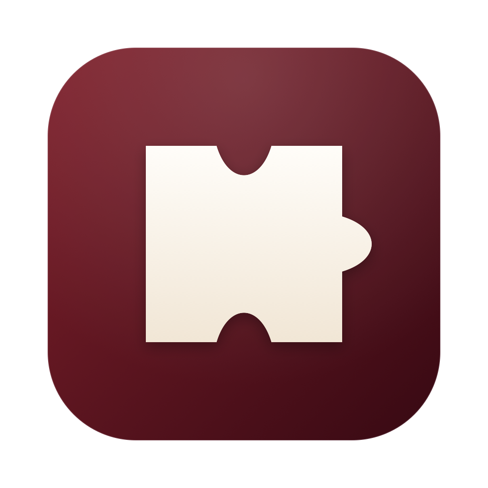

<p align="center">
  
</p>

<h1 align="center">Steam Mod Manager</h1>

<p align="center">
  <strong>面向 Paradox 游戏与 Steam 创意工坊游戏的桌面 Mod 管理器。</strong>
</p>

<p align="center">
  <a href="https://dotnet.microsoft.com/"></a>
  <a href="https://avaloniaui.net/"></a>
  
  <a href="https://github.com/zxxwyt/steam-mod-manager-community/actions/workflows/build.yml"></a>
</p>

<p align="center">
  <a href="README.md">English</a> | 简体中文
</p>

---

## 这是什么？

Steam Mod Manager 让 Mod 管理集中在一个窗口里：发现本机 Steam 游戏、扫描本地与工坊内容、搜索 Steam 创意工坊，并按游戏维护各自的 Mod 清单。

从左侧切换当前游戏，本地 Mod、创意工坊浏览、版本筛选、运行配置和顶部“启动游戏”都会随之切换。点击“应用到游戏”可将运行配置写入游戏启动器。

## 要解决的问题

Steam 创意工坊的条目不一定能看出 Mod 是否匹配你安装的游戏版本。很多人只能先订阅、等下载完成、进入游戏后才发现版本冲突，有时存档已经出问题，再逐个关闭 Mod 排查。

Steam Mod Manager 在订阅或启用之前读取 Mod 描述文件里声明的 `supported_version`，在工坊列表、本地 Mod 列表和运行配置中显示 **兼容 / 不兼容 / 未知** 标记，让版本问题在下载前就能看到，而不是进游戏后才发现。它是按声明版本判断，不代表运行时一定兼容，但能把创意工坊最常见的“下载完才知道版本不对”提前暴露出来。

## 功能

### 游戏发现

- 启动时读取本机所有 Steam 库和已安装游戏清单。
- 只有支持创意工坊的游戏才会加入列表：依据本地工坊目录、`appworkshop_<AppId>.acf` 或 Steam 商店的创意工坊类别判断。
- 支持默认 Steam 位置、`libraryfolders.vdf` 中的所有库，以及其他游戏保存过的 Steam 路径。
- 每个游戏独立保存路径、配置、搜索条件和版本选择。

### 本地 Mod

- 扫描本地 Mod 和工坊下载内容，读取版本声明与描述文件依赖。
- 在 CK3 本地库选择「安装本地 Mod」，从含有一个 `descriptor.mod` 的 ZIP 或文件夹预览并安装。
- 文件新增或删除时自动更新 Mod 列表。
- 同一工坊 Mod 存在多份可用安装时标记副本，悬停查看各自的版本、来源和路径。缺少工坊身份的同名安装标为疑似副本。
- 选中已安装 Mod 后，可确认从磁盘删除。支持 Steam 桥接的游戏会先取消工坊订阅。
- 根据声明版本显示绿色“兼容”、红色“不兼容”、灰色“未知”。

### Steam 创意工坊

- 在软件内按名称、类型、作者声明的游戏版本搜索，支持排序和分页。
- 可直接输入页码跳转，超出范围会自动钳制。
- 在应用内查看封面、作者介绍和版本变体。
- 同一游戏、同一作者的同名发布聚合为一张卡片；其他作者的汉化和补丁分别保留。

### 运行配置

- 为每个游戏添加、移除和启停 Mod。拖动清单行首的手柄调整加载顺序，也可使用上移、下移按钮。
- CK3 的「检查文件冲突」列出当前清单中启用 Mod 的同路径文件、内容差异和配置顺序，并报告 `common/traits` 顶层特质重名及描述文件的 `replace_path`。
- 「检查依赖」显示缺失、未启用、歧义和循环，确认后可将缺失的工坊前置加入下载任务。
- 导入配置时显示清单版本与本机版本。发现异版时可明确使用某个副本，或保留待匹配项。
- CK3 运行配置可导出 `.ck3pack`。快照包包含启用项的 Mod 文件、声明版本、加载顺序和启停。接收方使用相同 CK3 版本校验并恢复为独立配置，再选择是否应用到游戏。禁用项保留清单记录。
- “应用到游戏”把当前清单写入游戏启动器播放集。
- “启动游戏”会先核对当前配置，有未应用改动时自动应用，再启动游戏。

### 下载

- 通过本机已登录的 Steam 客户端订阅并下载工坊内容。
- 显示 Steam 真实字节进度、速度和安装结果。
- 同一游戏、同一工坊项只保留一个活跃任务，支持停止跟踪、重试、复用已安装内容和检查更新。移除任务时保留 Steam 管理的文件。

### 界面语言与 CK3 诊断

- 在「路径设置 → 界面语言」切换简体中文或英文。选择对所有游戏生效，下次启动时沿用。
- 在 CK3 侧栏打开「CK3 诊断」，点击「读取日志」，可查看最近会话和最多五份历史崩溃报告。选择来源后可读日志尾部、核对时间或打开所在目录。

### 兼容性

兼容标签依据 Mod 描述文件声明的 `supported_version`，不是运行时实测结论。绿色表示声明版本前缀与当前游戏版本匹配，红色表示不匹配，灰色表示版本未知或无法比较。

## 快速开始

### 环境要求

- [.NET 10 SDK](https://dotnet.microsoft.com/download/dotnet/10.0)
- Steam 安装以及受支持的游戏（完整体验需要）

### 从源码运行

```shell
dotnet restore SteamModManager.sln
dotnet run --project src/Ck3ModManager.Desktop
```

在 macOS 或 Linux 上，也可执行 `bash scripts/run-desktop.sh`。

### 构建 macOS 应用

```shell
bash scripts/package-macos-app.sh
```

脚本会生成 `artifacts/macos-app/Steam Mod Manager.app`，这是自包含的 arm64 应用包。

### 命令行诊断

```shell
dotnet run --project src/Ck3ModManager.Cli -- doctor
dotnet run --project src/Ck3ModManager.Cli -- workshop 2273832430
dotnet run --project src/Ck3ModManager.Cli -- browse RICE
dotnet run --project src/Ck3ModManager.Cli -- profiles
dotnet run --project src/Ck3ModManager.Cli -- download <工坊 ID>
dotnet run --project src/Ck3ModManager.Cli -- games
```

`doctor` 只读取本地环境。默认游戏为 `ck3`，命令前加 `--game <游戏 ID>` 可切换。

## 构建与测试

```shell
dotnet build SteamModManager.sln --configuration Release
dotnet test --solution SteamModManager.sln --configuration Release --no-build
```

测试采用 Microsoft.Testing.Platform，覆盖 Core/Application 单元测试、Steam HTTP 与文件系统夹具测试、Avalonia 无窗口界面测试。测试不要求安装游戏、不联网、不修改真实游戏文件。

GitHub Actions 会在 Windows、macOS 和 Linux 上构建和测试。这些是开发构建，目前没有签名安装包。

## 文档

- [当前架构与 Steam 接入边界](docs/architecture.md)
- [工坊缓存与加载流程](docs/workshop-cache.md)
- [Steam 客户端下载与进度同步](docs/workshop-download.md)
- [启用、禁用与播放集应用](docs/game-mod-activation.md)
- [竞品调研与 PCL 运作模式](docs/research.md)
- [开发与 PR 提交规范](CONTRIBUTING.md)
- [第三方依赖声明](THIRD-PARTY-NOTICES.md)

## 贡献

欢迎用中文或英文提交 Issue 和 PR。玩家可以分享可复现的问题，Mod 作者可以提供小型冲突或依赖案例，也欢迎贡献代码、测试、翻译、无障碍和文档改进。发起 PR 前可阅读[贡献指南](CONTRIBUTING.md)。

## 许可证

项目自有代码采用 [MIT 许可证](LICENSE)。第三方组件沿用各自的许可证，见[第三方依赖声明](THIRD-PARTY-NOTICES.md)。

## 致谢

PCL（Plain Craft Launcher）是产品模式和架构研究的参考项目。界面借鉴其侧栏、搜索卡片、资源列表和软件内详情流程，使用独立编写的 Avalonia 组件。

## 命名说明

产品名称是 **Steam Mod Manager**。解决方案为 `SteamModManager.sln`。内部 .NET 命名空间和应用数据目录沿用历史上的 `Ck3ModManager`，以兼容已有设置和配置。
