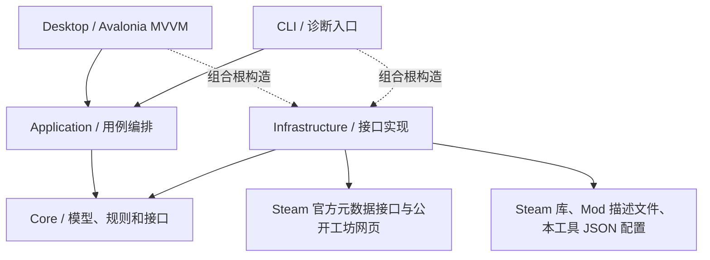

# 当前架构与 Steam 接入

更新于 2026-11-07。本文记录当前工程的分层、数据归属与 Steam 接入。

## 架构约定

### 工程职责

| 工程 | 已实现职责 |
| --- | --- |
| `Ck3ModManager.Core` | 游戏目录、Mod、工坊物品、安装内容和配置模型；接口；工坊引用校验；版本声明比较。 |
| `Ck3ModManager.Application` | `WorkspaceService` 组织路径设置、游戏发现、本地扫描、配置存储；`WorkshopService` 编排列表搜索、封面读取和当前游戏工坊物品核对。 |
| `Ck3ModManager.Infrastructure` | Steam 元数据 HTTP、公开网页列表解析、受限来源封面读取、Steam 库发现、描述文件解析、JSON 原子写入及系统导航。 |
| `Ck3ModManager.Desktop` | 中文桌面界面、视图模型和命令；不在界面中解析 VDF、读写 JSON 或发送 HTTP。 |
| `Ck3ModManager.Cli` | 复用应用服务，提供 `doctor`、`workshop`、`browse`、`profiles` 诊断入口。 |

Desktop 和 CLI 在组合根构造 Infrastructure 具体实现，应用层只通过 Core 接口调用适配器。新功能优先扩展已有用例和写入入口。常见任务的代码与测试入口见[仓库导航](repo-map.md)。

### 允许的项目引用

| 引用方 | 允许直接引用 |
| --- | --- |
| Core | 无仓库内项目引用 |
| Application、Infrastructure | Core |
| Desktop、CLI | Core、Application、Infrastructure |

[项目引用检查](../Directory.Build.targets)在构建时检查 `src/<工程名>/<工程名>.csproj` 的实际项目引用，违例报 `SMM001`。测试工程、层内类型引用、包依赖及运行时行为仍需相应测试或人工审查。新增模块或改变允许方向时，先在该变更的 Spec 写明原因和受影响调用方。

### 关键数据归属

| 数据或状态 | 权威来源与写入边界 |
| --- | --- |
| 下载活跃状态与任务历史 | `WorkshopDownloadService` 统一编排，`FileWorkshopDownloadStore` 持久化任务与管理物品锁。Desktop 消费快照。 |
| Steam 订阅、排队、字节及安装状态 | 本机 Steam 客户端提供，原生桥接按 App ID 与工坊 ID 转发，工坊清单只读。 |
| 已安装 Mod 与删除 | 扫描器提供磁盘快照，`LocalModLibrary` 统一接收扫描、比较变化并核对当前安装。删除前由 `WorkspaceService` 重新确认目标，再交给 `InstalledModRemover`。下载历史和当前安装分别展示。 |
| 配置与游戏启动器状态 | Application 负责导入复核、保存与下载排队，以及启动前核对、应用和读回。Desktop 管理草稿与确认，`JsonProfileStore` 持久化配置，`ParadoxGameModActivator` 写入启动器播放集。 |

历史安装仍可通过原有扫描、配置和旧版下载存储识别。安装 ID 按路径计算，相关配置可能继续引用旧版本。若要淘汰历史安装路径，需先验证存量数据的识别、迁移和回退，再在独立 Spec 中确认兼容边界。

## 游戏与工作区边界

`GameDefinition` 与 `GameCatalog` 保存首批 CK3、HOI4、EU4、Stellaris、Victoria 3、Imperator 的 Steam App ID、显示名称、用户目录名和程序位置。游戏定义为不可变配置，路径发现、工坊服务与外部导航在构造时绑定同一游戏；旧构造默认 CK3，保留既有调用兼容。

列表 URL、公开网页中的查询与条目、详情响应、版本标题和项目分组均使用游戏身份。不同游戏的同名项目不会合并。每个游戏拥有独立的工坊对象缓存与桌面最近详情状态，底层 HTTP 客户端和受限 Steam 图片字节缓存可以共享。

左侧提供游戏选择，首次进入该游戏时读取对应设置并扫描；切回已经打开的游戏直接恢复原视图模型。未找到游戏目录或无法识别版本时，使用当前游戏的路径设置或手动目标版本，不把其他游戏的路径和版本当作结果。

## Steam 是唯一在线来源

首版通过官方 `ISteamRemoteStorage/GetPublishedFileDetails/v1/` POST 接口按 ID 查询，使用 `itemcount` 和 `publishedfileids[0]` 参数，不需要 API key。校验返回物品 ID、Steam 结果码以及 `consumer_app_id == 当前游戏的 App ID`，不会把上传工具的 `creator_app_id` 误认为游戏 ID。

全目录浏览由 `SteamWorkshopBrowser` 读取 `steamcommunity.com/workshop/browse/` 的公开服务端结构化数据（`valve-ssr-data` → `renderContext.queryData` → `workshop_browse` 查询），支持名称、排序、分类/版本标签与分页。返回页码、当前游戏的 App ID 与结果结构都会校验；空结果与格式失败分别处理，不从介绍中的任意链接提取列表。此入口属于网页适配器，不是稳定的官方 Web API。官方 `IPublishedFileService/QueryFiles` 需要 API key，本实现不在客户端嵌入 publisher key。

`WorkshopService` 组织按游戏隔离的 L1 内存／L2 JSON 对象缓存，列表与完整详情以 2 分钟为新鲜期、24 小时为资料保留期；不同搜索条件分开保存。桌面通过 Observe 接口先显示已有资料，再按需后台更新；显式“更新资料”强制访问来源。组合根关闭浏览器自身的页缓存，避免独立期限叠加。HTTP 客户端协商压缩，网页解析在异步网络上下文继续，避免占用界面线程。历史性能采样与边界见 [性能诊断](workshop-performance.md)。

`SteamWorkshopImageSource` 仅接受 HTTPS 的 Steam 图片来源，逐次核验重定向，限制响应大小和同时下载数量。封面异步加载，失败保留占位，不妨碍文字详情。界面保持搜索和分页上下文，详情返回后仍可继续浏览。

此基础详情接口没有稳定提供完整依赖或历史发布清单。因此 `WorkshopItem.RequiredItemIds == null` 表示依赖未知，界面不会据此判定“没有依赖”或“依赖检查通过”。本地描述文件的 `dependencies` 另行展示为作者声明。

桌面端和 CLI 由 `WorkshopDownloadService` 按游戏和工坊 ID 复用活跃任务，再由 `SteamClientWorkshopDownloader` 启动桥接进程订阅或跟踪 Steam 的下载。Steam 负责文件安装，应用核对安装路径和本地内容后刷新 Mod 库。下载历史通过物品锁防止跨实例冲突，移除任务时保留 Steam 文件。详见 [应用内下载说明](workshop-download.md)。

官方依据：[公开工坊列表](https://steamcommunity.com/workshop/browse/?appid=1158310)、[列表 API 的 key 要求](https://partner.steamgames.com/doc/webapi/IPublishedFileService#QueryFiles)、[元数据接口](https://partner.steamgames.com/doc/webapi/ISteamRemoteStorage#GetPublishedFileDetails)、[订阅接口的客户端限制](https://partner.steamgames.com/doc/webapi/ISteamRemoteStorage#SubscribePublishedFile)、[原生依赖查询能力](https://partner.steamgames.com/doc/api/ISteamUGC#GetQueryUGCChildren)。原生 Steamworks 桥接在当前游戏上下文运行，订阅操作需要本机 Steam 登录状态。

每次从导航打开创意工坊页面时更新当前查询的在线列表，可先显示已有缓存再完成本次来源请求；停留期间没有定时刷新。从详情返回列表保留已有结果，不触发新的开页请求。

## 发布版本聚合与推荐

`WorkshopCatalog` 按工坊 ID 去重，并将同一作者、规范化同名的已加载条目聚合为 `WorkshopProject`。明确的末尾当前游戏名称与版本标记可剥离；裸数字尾标只有与该条目自己的游戏版本标签完全一致时才剥离。不同作者、作者未知、汉化/补丁后缀及普通数字不被模糊合并。本轮聚合范围为已加载的 Steam 页面，页数与总数仍保留 Steam 发布项统计。

每个 `WorkshopReleaseChoice` 对应一个真实工坊发布 ID，可包含多个作者标记的游戏适配版本；多个标签不会生成多个虚构历史文件。模组自身版本仅从明确 `v2.0` 这类标记读取，信息不足则保留未知。

领域排序仍支持声明匹配、未知和不符的完整诊断；桌面选择器默认采用本机检测出的当前游戏版本，只向用户展示 `DeclaredMatch`。行内、详情、顶部版本标签与订阅入口均保持这一限制；未知或不匹配的发布被隐藏。最新详情还会回填本页数据；有效保留期内，同修订的完整详情优先于较旧或不完整的列表资料，避免重复搜索恢复已知失配项。较新修订的列表会使旧完整介绍失效，并在需要时重新补查。过期或更新失败的详情可继续浏览，订阅入口等待新鲜的完整资料。未识别目标版本时先确认路径或填写版本。用户也可覆盖目标版本，随后从保留的完整本页数据重新筛选，既能移除失配项，也能恢复之前隐藏的匹配组。现阶段依据作者声明，没有实测证据，不输出兼容百分比。

列表和详情的版本下拉共享选中的发布 ID；切换时封面、说明、标签与 Steam 订阅入口一起更新，返回列表仍保留仍然匹配的所选项。目标版本变化会重新筛选列表候选项，并关闭不再匹配的详情与订阅入口。

## 本地发现与安装身份

游戏发现只访问已知 Steam 根目录及 `libraryfolders.vdf` 声明的库，通过当前游戏的 `appmanifest_<App ID>.acf` 查找安装目录。支持 Windows、macOS、Linux 的默认位置和手动覆盖，识别普通二进制及 macOS 应用包。

游戏版本从可读取的游戏配置或版本文件获取，移除显示用代号后再比较；`Steam buildid` 不冒充游戏版本。无法读取时保留未知。

Mod 扫描读取用户数据目录下的 `.mod` 文件和 Workshop 内容中的 `descriptor.mod`；支持引号、注释、转义路径和依赖列表。坏文件产生警告，不中止其他 Mod 的扫描。

安装 ID 按规范化内容位置生成，工坊 ID 另存。扫描用同一规则区分 Steam 管理、本地、应用自管和外部路径。标签、批量更新与删除按管理方式处理，配置匹配仍可使用工坊 ID。指向同一内容目录的包装描述文件会去重；不同目录中的旧版备份和新版即使工坊 ID 相同，也会保留为不同安装内容。配置清单同时加入同一工坊项目的两个副本时会被拒绝。

当前路径 ID 不是内容哈希，也不代表内容已经冻结；逐文件内容指纹和快照属于后续阶段。

`ILocalModMonitor` 由 Infrastructure 的 `FileSystemLocalModMonitor` 实现，使用文件系统事件监听当前游戏的 Mod 目录。启动时建立一次快照，之后只有相关新增、删除、重命名等文件事件触发重新扫描；监听器传递原始扫描。本地库统一比较安装身份、可用性和描述文件元数据，并按扫描起点拒绝迟到快照。同路径更新版本或兼容声明会更新列表。短暂的一次性事件合并用于避免同一次安装产生大量重复处理，不设置周期扫描。不存在的目录通过监听最近存在的父目录逐层接入；Steam 库清单变化时重新发现路径。

Desktop 消费本地库快照，更新安装列表、下载卡片、扫描警告和时间，保留配置草稿、选中安装身份与工坊请求。游戏切走时停止监听，切回重新接入；取消后的旧快照通过操作身份校验丢弃，退出释放监听资源。界面移除“刷新本地”按钮，路径设置仍可保存并重新扫描。

## PCL 交互参考

参考 PCL 的 `PageResource.xaml` 搜索/结果/分页卡片和 `MyResourceItem.xaml` 图标摘要行；点击条目后在应用内进入详情，并保留搜索上下文。页面切换统一使用左侧导航，顶部仅保留品牌与“启动游戏”操作，避免重复入口。详情独立增加工坊封面与作者介绍。PCL 的版本下载机制不直接移植为 游戏历史版本承诺；桌面 UI 与所有业务实现均为本项目独立编写。

## 配置、状态与存储

`ModProfile` 保存目标游戏版本和有序 `ProfileMod` 清单，包含安装 ID、Mod 名称、内容路径、工坊 ID、作者支持的游戏版本、Mod 版本字符串及 `Enabled`。旧 JSON 未提供 `Enabled` 时默认为启用；禁用保留条目与顺序。

桌面层由 `GameWorkspaceManager` 按游戏缓存独立的视图模型与初始化任务；切换只替换窗口 DataContext，每个游戏的草稿、筛选条件、结果与异步操作保留在自己的工作区。桌面层支持异步操作状态、取消、错误反馈及内存草稿。切换配置和刷新环境时保留未保存草稿；保存成功后才清除对应草稿。退出应用前仍需主动保存。

路径设置和配置通过 `GameStorage.GetDirectory` 按游戏隔离：CK3 继续使用当前用户应用数据目录下原有的 `Ck3ModManager/settings.json` 和 `profiles.json`，其他游戏使用 `Ck3ModManager/games/<游戏 ID>/` 下的同名文件。通过同目录临时文件、刷盘和移动替换写入；读取失败或 JSON 损坏时报告错误，拒绝静默覆盖原文件。

顶部“启动游戏”在当前配置有待处理改动时先应用，应用失败则不发出启动请求；随后通过系统打开 `steam://rungameid/<当前游戏 App ID>`。App ID 来自内置游戏目录。界面只报告请求已交给 Steam，不据此判断游戏进程已经启动。

`WorkspaceService` 通过 `IGameModActivator` 编排实际配置应用，提交前重新发现游戏并扫描文件。`ParadoxGameModActivator` 检查安装目录的启动器协议与数据库结构，在进程检查及跨实例锁保护下在线备份数据库，然后用单一 SQLite 事务更新独立本地播放集、启停标记、位置及活动播放集选择。原有播放集内容保留，DLC 选择继承当前活动播放集；备份最多五份，失败同样受限。官方启动器负责生成 `dlc_load.json` / `content_load.json`，本工具不直接修改这些派生文件或游戏存档。详细边界见 [配置应用说明](game-mod-activation.md)。

## 验证与后续边界

自动化覆盖：工坊公开列表解析、搜索转义、分页和来源校验、网页结构错误、封面来源/重定向/大小限制、工坊 URL/ID 校验、版本声明匹配与未知状态、HTTP 成功和失败、非当前游戏物品、取消、VDF 多库、macOS 包、描述文件边界、安装去重、多个版本副本、配置顺序重载、损坏 JSON 保护、草稿与界面绑定。

实际联调已经通过 Steam 查询 RICE 工坊物品，且本机能发现 CK3 与本地 Mod。真实机器扫描结果不作为测试夹具或项目数据提交。

下一步可在现有接口上实现：配置应用差异预览、内容指纹和快照、依赖来源补充及版本规则、经验证的兼容配置。每项能力应独立验证，不能把作者版本声明、文件一致性或游戏进程启动成功当作完整兼容证明。
