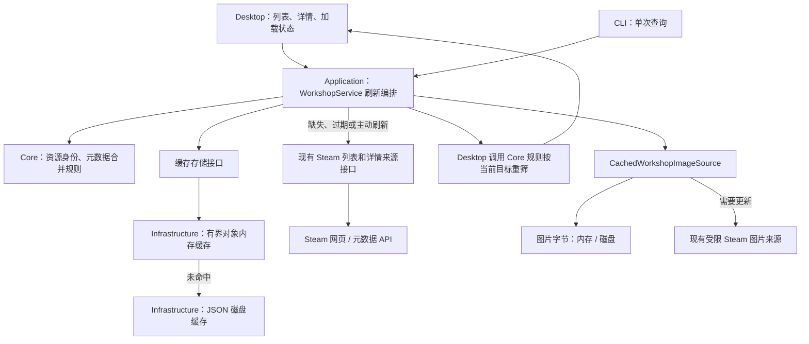

# Steam Mod Manager 工坊缓存架构方案

实施更新（2026-11-01）：浏览资料、详情按需补查与图片磁盘缓存已落地，当前行为和范围见[工坊缓存与加载流程](workshop-cache.md)。下文保留原完整设计，其中预取、通用 HTTP 缓存、全范围清理代次及本地扫描缓存仍是设计目标。

日期：2026-10-28。状态：**建议采用的初版架构，尚未实施**。依据：[MC／CK3 缓存共性](cache-common-model.md)、[首屏性能诊断](workshop-performance.md)。这里“直接沿用 PCL”指策略、对象划分和流程，具体实现按本项目的 C#／Avalonia 编写。

## 1. 架构决定

采用 **分层共用：共享传输缓存基础，项目对象通过上下文直接复用，各类对象缓存独立管理**。Application 负责按需读取与刷新，业务对象可使用 L1 内存／L2 本地文件，图片独立管理。Steam HTML／JSON 继续由来源适配器读取，HTTP 缓存仅在具体响应支持时参与。缓存先解决浏览资料、封面和首屏等待，实际 Mod 订阅与下载继续交给 Steam。

首版选择现有 .NET 能力下的有界内存字典、JSON 和图片二进制文件，放在本工具应用数据目录。暂不引入 Redis、数据库或独立服务；存储通过接口隔离，未来确有容量或事务需求再替换。来源读取与存储选择相互独立，不要求先改成 Steam API。

当前工程已有 Core、Application、Infrastructure、Desktop／CLI 边界和来源接口；列表已解析成对象后做内存缓存，官方页面跳转由独立导航器执行，因此可以沿现有结构增量改造。[VERIFY: src/Ck3ModManager.Core/Contracts.cs:3] [VERIFY: src/Ck3ModManager.Core/Contracts.cs:8] [VERIFY: src/Ck3ModManager.Core/Contracts.cs:13] [VERIFY: src/Ck3ModManager.Application/WorkshopService.cs:9] [VERIFY: src/Ck3ModManager.Infrastructure/SteamWorkshopBrowser.cs:42] [VERIFY: src/Ck3ModManager.Infrastructure/ExternalNavigator.cs:12]

### 2026-10-28 补充：列表与详情按层共用

这项澄清修正了前版“进入详情立即再次核验”的默认流程。后续实现以本节及第 5 节为准，不把列表和详情设计成同一个对象缓存，也不要求打开详情前必定再查一次项目资料。

| 层次 | PCL 的实际路径 | 本项目方案 |
| --- | --- | --- |
| **共享 HTTP 传输缓存** | 社区搜索、版本与项目补查经 `DlModRequest → NetRequestByClient → SendRequest`，使用同一个 RequestClient／CacheCow FileStore。 | 列表与资料补查共用元数据 HTTP 客户端及可选缓存 handler；响应能否直接复用或 304 仍取决于 HTTP 缓存规则。 |
| **项目对象传递** | 详情页从页面参数接收 `ResourceProject`，直接展示；正常列表进入不为项目基础资料再发一次请求。项目字典主要服务按 ID 查找、前置项目补全及其他复用入口。 | 列表点击传 `DetailContext(WorkshopProject, SelectedPublishedFileId)`，保留 Releases、所选条目和已有字段，先展示详情上半部。已有完整且仍可用的详情也直接复用。 |
| **独立发布／版本列表缓存** | 详情加载 `ResourceVersion.FromProjectId`，由独立的 ProjectFilesCache 缓存；首次获取版本列表与基础项目介绍复用是两回事。 | 当前 Releases 是本页已加载条目的聚合，不另发请求虚构历史版本列表；将来真正接入发布／修订查询后，再独立设计该缓存。 |
| **独立本地 Mod 资料缓存** | LocalMod.json 有自己的文件、内容／环境键、格式版本与六小时条件。 | 本地描述文件／线上关联缓存与浏览对象的期限和失效条件分开管理，可复用底层文件工具。 |

源码依据：PCL 详情从页面参数取项目并展示，版本加载器另查版本列表；对应项目／版本字典并非同一个字典。版本获取内部仍可能通过项目字典补缺，因此清空缓存或按 ID 进入时可能发生项目补查，不能扩大成所有路径绝不请求项目。[VERIFY: PCL/Plain Craft Launcher 2/Pages/PageDownload/Resource/PageDownloadCompDetail.xaml.vb:15] [VERIFY: PCL/Plain Craft Launcher 2/Pages/PageDownload/Resource/PageDownloadCompDetail.xaml.vb:28] [VERIFY: PCL/Plain Craft Launcher 2/Pages/PageDownload/Resource/PageDownloadCompDetail.xaml.vb:317] [VERIFY: PCL/Plain Craft Launcher 2/Modules/Resource/ResourceProject.vb:386] [VERIFY: PCL/Plain Craft Launcher 2/Modules/Resource/ResourceProject.vb:393] [VERIFY: PCL/Plain Craft Launcher 2/Modules/Resource/ResourceProject.vb:404] [VERIFY: PCL/Plain Craft Launcher 2/Modules/Resource/ResourceVersion.vb:229] [VERIFY: PCL/Plain Craft Launcher 2/Modules/Resource/ResourceVersion.vb:231] [VERIFY: PCL/Plain Craft Launcher 2/Modules/Minecraft/ModDownload.vb:1202] [VERIFY: PCL/Plain Craft Launcher 2/Modules/Base/ModNet.vb:226]

PCL 的本地资料持久化缓存独立，不表示任何内存对象都不共享：本地在线加载也会复用 ResourceProject.Cache。因此这里区分文件、对象种类与失效规则，不把模块隔离理解为禁止资料复用。[VERIFY: PCL/Plain Craft Launcher 2/Modules/Resource/LocalResourceLoaders.vb:109] [VERIFY: PCL/Plain Craft Launcher 2/Modules/Resource/LocalResourceLoaders.vb:113] [VERIFY: PCL/Plain Craft Launcher 2/Modules/Resource/LocalResourceLoaders.vb:144]

传输层也不能只用“URL 相同就一定命中”概括：HTTP 方法、响应指令、Vary 等共同影响复用；CK3 详情是携带物品 ID 的 POST，同 URL 的不同请求体不能共用错误的响应。此前实际响应头采样仍然有效，不能因为共享 handler 就承诺列表必有 ETag／304。[VERIFY: src/Ck3ModManager.Infrastructure/SteamWorkshopSource.cs:20] [VERIFY: src/Ck3ModManager.Infrastructure/SteamWorkshopSource.cs:25]

## 2. 总体架构

下图为拟建运行时调用关系；模块和箭头不代表当前已经实现。



### 各层职责

| 层 | 保留／新增职责 | 不承担的职责 |
| --- | --- | --- |
| **Core** | 保留 `WorkshopItem`、`WorkshopBrowsePage`、适配规则；新增缓存键、条目元信息、缓存存储端口及元数据合并规则。 | 文件路径、HTTP 头、Avalonia Bitmap。 |
| **Application** | 扩展现有 `WorkshopService`：读取缓存、决定是否刷新、单次或两阶段结果通知、同请求合并、取消和刷新状态；统一执行元数据合并。 | 解析 HTML、操作磁盘文件、修改控件。 |
| **Infrastructure** | 实现对象内存／文件存储、原子写入、容量清理、图片缓存、可选 HTTP 协商；保留来源校验与解析。 | 把缓存当兼容结论，或以下载镜像替换 Steam。 |
| **Desktop** | 显示资料时间与加载状态，按当前目标版本使用现有领域规则重筛；只接受当前请求的更新，保留仍有效的用户选择。 | 在视图模型里另建一套持久缓存或直接发 HTTP。 |
| **CLI／组合根** | Desktop 与 CLI 在组合根注入存储和来源；CLI 保留单次返回，诊断可显式强制联网。 | 为简单诊断强制启动界面。 |

依赖规则沿用现有项目方向：Application 依赖 Core 中的接口；Infrastructure 实现接口；Desktop／CLI 负责组合，不让缓存文件实现反向进入 Core。

### 计划的最小模块

| 模块 | 放置位置 | 明确作用 |
| --- | --- | --- |
| `CacheEntry<T>`、`CacheKey`、`IWorkshopCacheStore`、`IWorkshopPreviewCache` | Core | 表达缓存对象及页面／条目读写端口；图片端口提供读取已缓存字节、刷新并返回新条目的能力。 |
| `WorkshopService` 的刷新流程 | Application | 新增列表与图片多阶段读取能力；保留一次取结果的调用方式。 |
| `WorkshopMetadataPolicy` | Core | 统一摘要、详情及不可用记录的合并规则，保留当前不降级原则。 |
| `CachePolicy`、同请求合并器 | Application | 配置各类期限、刷新方式、共享网络任务生命周期。 |
| `WorkshopCacheStore` | Infrastructure | 页面与条目资料的 L1／L2 实现，命中磁盘后回填内存。 |
| `CachedWorkshopImageSource` | Infrastructure | 实现原有图片字节接口及新增图片缓存端口；与内部传输配合，处理缓存和验证器。 |
| 内部 `SteamPreviewTransport`／`PreviewFetchResult` | Infrastructure | 从现有图片读取实现提取受限 HTTP 逻辑，保留状态、缓存指令、ETag／Last-Modified 与受限图片字节。 |
| 内部文件存储辅助类 | Infrastructure | 同键写入串行化、临时文件替换、损坏回退、代次与容量清理。 |

首版不新建通用缓存框架工程。搜索页、项目资料、未来的发布列表与本地扫描分别拥有缓存空间和失效规则，只共用基础存储工具与传输能力；图片独立计量。列表进入详情优先传对象，而非先从项目缓存重建或强制联网。本地扫描缓存后续按实际开销接入。

## 3. 哪些直接沿用，哪些独立设计

| 分类 | PCL 中的策略／模式 | 本项目方案 |
| --- | --- | --- |
| **直接沿用策略** | 列表向详情直接传项目对象；项目字典服务按 ID 补查与依赖补全。 | 详情接收整个聚合项目及所选发布 ID，已有字段直接显示；项目资料缓存与页面缓存分别管理。 |
| **直接沿用策略** | JSON 缓存带格式版本；不兼容可废弃。 | 缓存标明 `SchemaVersion`，格式或语义变化时重建。 |
| **直接沿用策略** | URL 对应图片文件；先展示已有图片，过期后台更新。 | 图片字节与列表行分离，跨重建、跨启动复用；沿用七天作为无来源缓存指令时的初始应用期限。 |
| **直接沿用策略** | 有资料、加载完整、未过期分别记录。 | 分开记录数据是否存在、采集时间、完整度和来源可用状态。 |
| **需要适配** | 项目 ID 作为对象键。 | 显式加入来源、游戏、对象种类；查询还须包含全部筛选和分页条件。 |
| **需要适配** | 本地在线信息六小时免联网。 | 保留按对象配置期限的机制；Steam 列表和详情先采用两分钟新鲜期限，不统一设六小时。 |
| **需要适配** | CacheCow HTTP 文件缓存。 | 保留按实际缓存头协商的模式，首版不直接绑定其旧客户端实现；列表主要缓存业务对象。 |
| **需要适配** | 缺失项目批量补齐、分页位置复用。 | 保留已加载页和仅补缺思想；批量详情按需求增加，当前首屏无需额外逐条补全。 |
| **需要适配** | 文件签名对应哈希计算结果。 | 描述文件可以采用完整高精度时间＋大小签名；整份目录指纹另外设计。 |
| **CK3 独立设计** | 来源项目与发布的区分。 | 工坊条目 ID、来源更新时间、安装位置和实际内容标识分开；不虚构不可变历史发布。 |
| **CK3 独立设计** | 旧资料展示后的更新。 | 完整来源页缓存、最近详情覆盖、目标版本重筛及明确不可用记录共同决定最终展示。 |
| **CK3 独立设计** | 图片／资料异步更新。 | 适配当前单次返回接口的两阶段通知、请求代次、取消和错误状态。 |
| **CK3 独立设计** | 本地单文件的变化检测。 | 描述文件缓存与目录逐文件内容清单分开；路径 ID 不作内容完整性依据。 |

PCL 依据：项目复用与批量补缺、格式版本、完整成功条件、七天图片文件缓存和单文件签名均已核对；HTTP 下载引擎入口明确不支持缓存协商，不能把它视为全局必经层。[VERIFY: PCL/Plain Craft Launcher 2/Modules/Resource/ResourceProject.vb:393] [VERIFY: PCL/Plain Craft Launcher 2/Modules/Resource/ResourceProject.vb:404] [VERIFY: PCL/Plain Craft Launcher 2/Modules/Resource/LocalResourceLoaders.vb:53] [VERIFY: PCL/Plain Craft Launcher 2/Modules/Resource/LocalResourceLoaders.vb:113] [VERIFY: PCL/Plain Craft Launcher 2/Controls/MyImage.vb:10] [VERIFY: PCL/Plain Craft Launcher 2/Controls/MyImage.vb:117] [VERIFY: PCL/Plain Craft Launcher 2/Modules/Resource/LocalResourceFile.vb:247] [VERIFY: PCL/Plain Craft Launcher 2/Modules/Base/ModNet.vb:142] [VERIFY: PCL/Plain Craft Launcher 2/Modules/Base/ModNet.vb:226]

当前 CK3 的特殊依据：详情每次仍联网，最近详情会覆盖较旧页面；目标改变会重筛；安装 ID 只哈希路径；图片 Bitmap 由每行管理并释放。这些约束决定缓存不能直接套在控件或一个 URL 字典上。[VERIFY: src/Ck3ModManager.Desktop/WorkshopViewModel.cs:294] [VERIFY: src/Ck3ModManager.Desktop/WorkshopViewModel.cs:343] [VERIFY: src/Ck3ModManager.Desktop/WorkshopViewModel.cs:424] [VERIFY: src/Ck3ModManager.Infrastructure/Ck3ModScanner.cs:124] [VERIFY: src/Ck3ModManager.Desktop/WorkshopViewModel.cs:130]

## 4. 缓存对象、键及初始策略

以下数值是**拟定的可配置初始值**，不是 Steam 保证或本轮实测。`新鲜期限` 和 `旧资料展示上限` 均从成功采集时间计算；读取旧文件或重新序列化不会刷新该时间。

| 对象 | 缓存身份 | 新鲜期限 | 旧资料展示上限／失效方式 |
| --- | --- | --- | --- |
| 原始查询页 | 来源＋App ID＋语言＋搜索词＋排序／热门周期＋全部标签＋页码／游标。 | 2 分钟。 | 最多 24 小时；期间需刷新，带旧资料标记；保留完整来源页及查询范围。 |
| 摘要／详情资料 | 来源＋App ID＋PublishedFileId；摘要、详情的观察记录分别保存。 | 2 分钟。 | 最多 24 小时，仅供浏览；先传对象展示，缺少完整资料、主动刷新或操作前需要当前核验时补查。 |
| 明确不可用的观察记录 | 同条目身份＋核验时间。 | 2 分钟。 | 期限内阻止旧页恢复可操作入口；过期为待核验，需在线成功后恢复。 |
| 封面字节 | 完整图片 URL＋请求变体；缩略图派生结果再含尺寸／解码版本。 | 来源缓存指令优先，本地新鲜期限最长 7 天；无来源指令时应用默认 7 天。 | 允许展示的旧图片最长 30 天；`no-store` 不保存，要求验证的响应先验证，不以本地期限覆盖来源约束。 |
| 描述文件解析 | 规范化文件路径＋完整 UTC 修改时间／大小＋解析器版本。 | 按输入变化失效。 | 签名只是快速复用线索，关键内容校验另行计算。 |
| 适配声明筛选 | 来源资料＋目标版本；将来若存结果，还须包含规则版本。 | **首版即时重算，不持久缓存判断结果。** | 目标、来源声明或规则变化即重算。 |

共同条目元信息：`SchemaVersion`、规范化键、`Payload`、`FetchedAt`、`FreshUntil`、`StaleUntil`、`Completeness`、来源更新时间／可用性观察。时间使用 UTC 并注入 `TimeProvider` 便于过期测试；来源更新时间只是比较依据，不冒充不可变文件修订。

初始容量：L1 保留现有 24 页和 128 项条目上限；图片字节 L1 最多 32 MiB。磁盘对象合计最多 32 MiB、页面最多 128 页；图片最多 256 MiB。先清理超期条目，再淘汰最久未使用条目；读取可更新使用时间但不延长新鲜期限。

单项限制独立于总容量：页面／条目 JSON 最多 4 MiB、图片字节最多 5 MiB、控制文件及单张图片索引最多 64 KiB。读取前检查长度，读取过程仍计数限制；超限或损坏视为未命中，不能先把整个大文件读入内存。缓存写入超过上限则跳过持久化，不把已成功的来源查询变成失败。

网络列表和图片已有 4 MiB／5 MiB 限制；详情目前没有同类正文限制。阶段 A 同时将详情改为响应头返回后有界读取、再解析 JSON，采用 4 MiB 解压后响应上限，避免把现状误写为已经全面有界。来源响应超限属于受控来源错误，与缓存写入失败分开处理。[VERIFY: src/Ck3ModManager.Infrastructure/SteamWorkshopBrowser.cs:40] [VERIFY: src/Ck3ModManager.Infrastructure/SteamWorkshopImageSource.cs:55] [VERIFY: src/Ck3ModManager.Infrastructure/SteamWorkshopSource.cs:25] [VERIFY: src/Ck3ModManager.Infrastructure/SteamWorkshopSource.cs:29]

原始页要自包含本次列表的条目快照，首次读盘不依赖逐条联网补资料；共享条目资料用于覆盖较旧快照。界面显示的匹配数量由当前目标版本重新计算，不只保存过滤后的几张卡片。当前完整页和目标重筛行为是该选择的基础。[VERIFY: src/Ck3ModManager.Core/Models.cs:35] [VERIFY: src/Ck3ModManager.Desktop/WorkshopViewModel.cs:269] [VERIFY: src/Ck3ModManager.Desktop/WorkshopViewModel.cs:445]

## 5. 首屏、详情及并发流程

### 首次进入资源页

1. `WorkshopService` 建立规范化查询键和本次请求编号，先读 L1，再读 L2；读盘、解析不占用界面线程。
2. 新鲜命中：发出资料快照，界面按当前目标版本筛选并显示；本次完成。
3. 有可展示的过期资料：先发出带采集时间的快照，再发出刷新状态，后台请求 Steam。
4. 完全缺失或格式不兼容：立即显示加载状态，执行网络请求；此时仍需要真实网络等待。
5. 来源成功并通过 App ID、页码和结构校验：先执行统一元数据合并规则，更新缓存，再发出新快照；界面保留仍有效的选择和位置。
6. 刷新失败：保留当前仍可展示的旧资料，显示刷新失败；不更新采集时间，不缓存网络错误为成功数据。

Application 对 Desktop 提供 `ObserveSearchAsync(...)` 一类多次通知接口，建议采用 `IAsyncEnumerable<WorkshopSearchUpdate>`；事件至少表达快照、刷新状态和错误。CLI 保留单次调用：只接收新鲜缓存或联网结果；诊断模式强制联网。该方法为拟建接口，当前 `SearchAsync` 仍只返回一次。[VERIFY: src/Ck3ModManager.Core/Contracts.cs:10] [VERIFY: src/Ck3ModManager.Desktop/WorkshopViewModel.cs:267]

Desktop 将工坊的 `InitialLoading`、`BackgroundRefreshing`、`ShowingData`、`RefreshFailed` 与全局本地操作 Busy 分开。缓存出现后的后台刷新不继续锁住搜索、分页和浏览；提交新查询替换旧界面等待。当前 `RunOperationAsync` 会从开始到网络结束一直持有 `IsBusy`，所以这一状态拆分是阶段 A 的必要改动，不能只增加文件存储。[VERIFY: src/Ck3ModManager.Desktop/MainWindowViewModel.cs:356] [VERIFY: src/Ck3ModManager.Desktop/MainWindowViewModel.cs:373]

### 点击详情与一致性

- **从列表进入**：直接传递 `WorkshopProject`、完整 Releases 集合和所选 PublishedFileId，复用所选 WorkshopItem 的标题、简介、封面、标签、时间、大小及已有订阅数，先显示详情上半部；不把 LookupAsync 作为打开页面的前置步骤。
- **按需补全**：完整描述缺失、资料过期且需要更新、用户主动刷新，或订阅入口需要当前核验时，再请求所选条目的详情；已有完整且新鲜的详情不因切换页面重复查询。简介不冒充完整介绍。订阅入口继续要求足够新且声明匹配的核验依据，单纯传入列表对象不能被当作已经完成详情核验。
- **从 ID／链接直接进入**：先尝试按身份查对象，缺失才执行 LookupAsync；如要实时核验则单独请求，不需要依赖列表页面。补全结果只更新对应发布，并保留同组其他 Releases、用户选择及原列表查询上下文。
- 摘要、详情分别保留采集证据。合并时保留当前“较旧数据不能降级新详情”的原则；来源更新时间相等时，在有效核验期限内优先使用详情的关键声明。更新时间更晚的列表可以使旧详情过期并触发重新核验，不将不同修订的字段拼成来源未曾返回的“完整版本”。
- 条目资料变化后，使当前已显示页的投影失效并重算；返回列表时也使用最新合并资料。不必同步重写包含该 ID 的所有持久页，读页时统一合并即可。
- 来源明确确认删除、私有或不可用时，保存短时不可用观察，旧页不得恢复操作入口。超时、5xx、解析失败只记刷新失败；Steam 返回码需要单独映射，不能把当前统称的异常一律判断为已删除。
- 目标游戏版本变化：原始资料继续复用，立即重筛并撤销不再匹配的选择／入口；若来源查询本身带了不适用的版本标签，则标记原查询需要重搜。

这些规则扩展现有的详情核验、最近详情覆盖和目标重筛；目前来源把非成功结果统一抛出异常，实施时需补充可区分的失败结果。[VERIFY: src/Ck3ModManager.Desktop/WorkshopViewModel.cs:294] [VERIFY: src/Ck3ModManager.Desktop/WorkshopViewModel.cs:175] [VERIFY: src/Ck3ModManager.Desktop/WorkshopViewModel.cs:374] [VERIFY: src/Ck3ModManager.Desktop/WorkshopViewModel.cs:424] [VERIFY: src/Ck3ModManager.Infrastructure/SteamWorkshopSource.cs:35]

当前实现确实先调用 LookupAsync，再 SetDetailProject；应拆开预览对象与按需补查。列表取的是 short_description，详情 API 取 description，这次往返对完整介绍或实时核验仍有用途，但不必阻塞已有字段展示。订阅数在列表中可取得且当前详情实现没有解析该计数字段，不应仅为已有订阅数再补一次请求。[VERIFY: src/Ck3ModManager.Desktop/WorkshopViewModel.cs:294] [VERIFY: src/Ck3ModManager.Desktop/WorkshopViewModel.cs:304] [VERIFY: src/Ck3ModManager.Desktop/WorkshopViewModel.cs:309] [VERIFY: src/Ck3ModManager.Infrastructure/SteamWorkshopBrowser.cs:102] [VERIFY: src/Ck3ModManager.Infrastructure/SteamWorkshopBrowser.cs:107] [VERIFY: src/Ck3ModManager.Infrastructure/SteamWorkshopSource.cs:54]

聚合语义也须准确：当前按 PublishedFileId 去重，再把同作者、规范化同名的多个条目聚合为一张项目卡片，卡片中保留多个 Releases。它不是把同一个工坊 ID 拆成多张卡片，也不等同于平台完整历史版本接口；详情上下文需要携带整个聚合项目。[VERIFY: src/Ck3ModManager.Core/WorkshopCatalog.cs:41] [VERIFY: src/Ck3ModManager.Core/WorkshopCatalog.cs:108] [VERIFY: src/Ck3ModManager.Desktop/WorkshopViewModel.cs:315]

### 请求与图片生命周期

同一来源查询＋缓存代次只执行一个在途网络任务，前台查询和预取可共享。调用者取消时先撤销自己的等待与界面通知；仍有使用者时不取消共享请求，无使用者且不是预取任务时取消底层请求。底层仍受应用退出和总超时约束。不同查询不得互相阻塞。

每个界面请求有编号；新查询或离开页面后，旧请求的完成事件不再写入当前界面。与显示无关的有效来源资料可以进入缓存，但不能越过清理代次。可在本地初始化完成后低优先级预取热门第一页；前台请求优先，不自动批量预取其他页面。

图片共享 bytes，不直接共享当前由行对象释放的 Bitmap。控件各自管理解码结果，避免一行销毁后使另一行的图失效；图片加载仍独立于文字快照，保留四路下载和来源／重定向校验。[VERIFY: src/Ck3ModManager.Desktop/WorkshopViewModel.cs:118] [VERIFY: src/Ck3ModManager.Desktop/WorkshopViewModel.cs:130] [VERIFY: src/Ck3ModManager.Desktop/WorkshopViewModel.cs:461] [VERIFY: src/Ck3ModManager.Infrastructure/SteamWorkshopImageSource.cs:11] [VERIFY: src/Ck3ModManager.Infrastructure/SteamWorkshopImageSource.cs:49]

现有公开图片接口只有 `byte[]` 返回值，简单套文件装饰器拿不到 HTTP 缓存头，也不能在返回旧图后再次通知新图。实施方案明确增加两处能力：[VERIFY: src/Ck3ModManager.Core/Contracts.cs:15]

1. Infrastructure 内提取受限图片传输：`PreviewFetchResult` 保留 `Modified／NotModified`、缓存指令、验证器和字节，304 时复用本地字节。现有网络图片实现可复用该传输，来源和跳转校验只维护一处，HTTP 元信息不进入界面。[VERIFY: src/Ck3ModManager.Infrastructure/SteamWorkshopImageSource.cs:43] [VERIFY: src/Ck3ModManager.Infrastructure/SteamWorkshopImageSource.cs:55]
2. Core 新增 `IWorkshopPreviewCache` 的缓存读取／刷新能力，Application 的 `ObservePreviewAsync` 发出旧字节快照和刷新后快照。Desktop 校验图片 URL＋行请求代次仍有效后替换 Bitmap；原 `IWorkshopImageSource` 保留给需要单次返回的调用方。这样本次方案完整支持“先显示旧图、后台新图替换当前图”，而不是只悄悄更新磁盘、等下次才生效。

## 6. 磁盘结构与可恢复性

建议放在 `LocalApplicationData/Ck3ModManager/cache/v1/`，与设置、配置清单和游戏文件分开：

```text
cache/v1/
  control.json # 格式版本与缓存清理代次；受短锁保护，不随普通条目清理
  pages/       # SHA256(规范化查询键).json，完整来源页快照
  items/       # SHA256(来源＋游戏＋条目ID).json，摘要／详情／可用性观察
  http/        # 可选共享 HTTP 响应缓存；普通对象刷新不删除此目录
  previews/    # 图片字节及 URL／HTTP 校验信息索引
  scan/        # 后续描述文件解析／内容计算缓存
```

- 对象写入采用同目录临时文件＋原子替换；同键写入串行化，提交前在短锁内重新检查来源证据和清理代次。Desktop／CLI 并存时，提交和清理须有跨进程短时互斥，不能持锁联网。
- 图片先写完整 blob，再原子发布其索引；缺少 blob 或索引损坏视为未命中，孤立文件由清理任务回收。图片来源仍须校验，磁盘命中不能绕过来源规则。
- 格式不符、截断或校验失败的缓存可丢弃重建；缓存不可写、满盘或清理失败不能使在线浏览整体失败。用户设置／运行配置不是可丢弃缓存，继续保持当前保护行为。
- **普通对象刷新**：清除／失效相关会话对象与投影，保留旧内容占位并重新加载；磁盘 HTTP 响应缓存保持，业务磁盘快照也可保留为带原采集时间的旧资料，不直接冒充新的加载结果。HTTP 层仍按来源规则命中或进行条件验证。
- **实时复核／诊断刷新**：要求来源重新验证，允许使用验证器获得 304，不等于必须重传正文；日志区分对象命中、HTTP 缓存命中、304 和新响应。
- **清理缓存**：显式按范围清理业务缓存、图片或 HTTP 响应缓存。相应范围先递增代次、清空 L1，再清理 L2；旧代次在途响应不得写回。普通刷新不隐式等同于全量磁盘清理。

PCL 的资源页刷新清除两个对象字典，没有在该入口删除 CacheCow 文件存储；本地 Mod 页另有删除 LocalMod.json 的刷新逻辑。这里沿用分层失效语义，能否获得 304 仍由具体响应与验证条件决定。[VERIFY: PCL/Plain Craft Launcher 2/Pages/PageDownload/PageDownloadLeft.xaml.vb:101] [VERIFY: PCL/Plain Craft Launcher 2/Pages/PageInstance/PageInstanceMod.xaml.vb:43] [VERIFY: PCL/Plain Craft Launcher 2/Modules/Base/ModNet.vb:223]

当前 JSON 配置已有临时文件替换写入；新缓存可复用这一写入思路，但损坏处理与配置文件必须区分。[VERIFY: src/Ck3ModManager.Infrastructure/JsonStores.cs:26] [VERIFY: src/Ck3ModManager.Infrastructure/JsonStores.cs:37] [VERIFY: src/Ck3ModManager.Infrastructure/JsonStores.cs:16]

## 7. 分阶段实施和验收

| 阶段 | 实施范围 | 必须通过的验收 |
| --- | --- | --- |
| **A：资料缓存与首屏** | 按层区分缓存与刷新；缓存键／条目、L1／L2 页面与条目存储；列表直接传详情上下文并按需补全；迁移最近详情合并；多阶段通知与工坊专用加载状态；清理代次；详情有界读取与错误分类。 | 新进程能先读旧页；列表点击无需等待重复 Lookup 才显示上半部；新鲜完整详情不重复查；直贴 ID 缺失时补查；Releases 与选择不丢失；普通刷新保留 HTTP 磁盘缓存；更换查询不串页；换目标重筛；旧资料不恢复失配项；网络／磁盘超限均受控。 |
| **B：图片缓存** | 图片内部传输响应元信息、图片缓存端口与更新通知、bytes L1／磁盘、来源缓存指令、容量与损坏重取。 | 重建列表／重启复用封面；过期图先显示且刷新成功后能替换当前图；共享字节不共享已被释放的 Bitmap；304、超期、损坏、重定向及 no-store 行为正确。 |
| **C：请求与诊断** | 前后台同请求合并、低优先级首页预取、命中／耗时／字节统计和强制刷新入口。 | 同请求只发一次；取消一名使用者不伤其他人；旧任务不回写新界面；清理后无晚写复活；能区分 L1、L2 和网络等待。 |
| **D：本地计算，按测量决定** | 描述文件解析缓存；将来需要内容校验时再增加逐文件清单。 | 文件变化会重算；目录内容变化不被路径 ID 掩盖；不使用描述文件签名冒充整份 Mod 完整性。 |

阶段 A 必须同时处理一致性与界面通知，不能只完成落盘就宣称“后台刷新已完成”。迁移后由新服务统一管理页面期限，删除或禁用 `SteamWorkshopBrowser` 原有内存缓存，避免两层独立两分钟策略互相遮蔽；相关缓存测试迁移到新的存储／编排测试，来源解析测试继续保留。[VERIFY: src/Ck3ModManager.Infrastructure/SteamWorkshopBrowser.cs:16] [VERIFY: src/Ck3ModManager.Infrastructure/SteamWorkshopBrowser.cs:22]

验收以可控时钟、临时目录和延迟来源覆盖过期、重启、取消、部分失败与格式升级；真实网络只用于采样，不把网络秒数写成自动化测试的固定阈值。性能统计分开记录首个缓存快照、最新快照、图片完成和真正 Mod 文件下载，不能用浏览命中率代替下载加速结果。

## 8. 取舍与边界

本方案优先解决已观察到的首屏等待，并为来源接口更换保留空间。代价是 Application 需要新增多阶段编排，缓存要承担过期、清理和元数据合并的一致性维护；JSON 文件适合当前规模，但跨文件操作不具备数据库事务能力，因此页面自包含、提交检查和可重建性必须明确。

首版不做三路重复请求竞速、不因不存在的整页详情 N+1 而增加请求、不增加输入自动搜索、不创建 Mod 镜像仓库。批量查询、目录内容快照和实际下载加速各自独立评估，不能计入本次缓存收益。[VERIFY: src/Ck3ModManager.Desktop/WorkshopViewModel.cs:267] [VERIFY: src/Ck3ModManager.Desktop/MainWindowViewModel.cs:154] [VERIFY: src/Ck3ModManager.Infrastructure/ExternalNavigator.cs:12]
