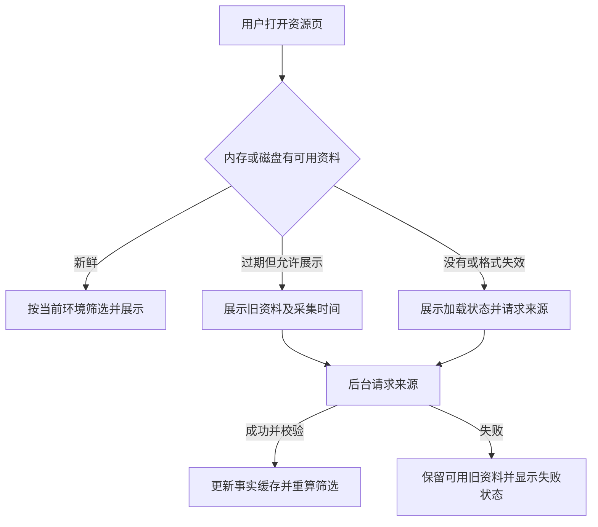

# MC 与 CK3 的缓存共性

记录日期：2026-10-28。MC 侧以本地 PCL 的 Mod 管理实现为样本，检出版本为 `93ede5d9e638c99fcec853a9ba1eecd91ceee7f5`；CK3 侧为当前管理器源码。本文提取共同设计，不表示 CK3 已实现全部缓存。`[VERIFY: PCL/...:行号]` 从本项目上级工作目录定位，其他源码路径从本项目根目录定位。

基于本对照形成的模块划分、期限初值和迁移安排见[缓存架构方案](cache-architecture.md)。

后续澄清：共性按层组织，不把列表、项目详情、发布列表和本地在线资料合并为一个对象缓存。PCL 正常从列表进入详情直接传项目对象，详情的新增请求主要是独立发布列表；CK3 应先传聚合项目和所选发布，已有字段直接展示，缺失资料按需补全。HTTP 传输缓存可共用，但各类对象拥有自己的生命周期。[VERIFY: PCL/Plain Craft Launcher 2/Pages/PageDownload/Resource/PageDownloadCompDetail.xaml.vb:15] [VERIFY: PCL/Plain Craft Launcher 2/Pages/PageDownload/Resource/PageDownloadCompDetail.xaml.vb:28] [VERIFY: src/Ck3ModManager.Desktop/WorkshopViewModel.cs:294] [VERIFY: src/Ck3ModManager.Desktop/WorkshopViewModel.cs:315]

## 共性集中在资源业务对象

两边都有“搜索条件与结果”“线上项目资料”“运行环境”“磁盘上的安装内容”等对象。同一份资料会被浏览、详情与本地管理重复使用，因此可以围绕资源对象组织缓存。缓存载荷不必绑定远端是 HTML 还是 JSON：CK3 已经先把工坊网页解析为 `WorkshopBrowsePage`，再放入对象字典；PCL 也在解析后保存 `ResourceProject`。这是共同模型的源码基础。[VERIFY: src/Ck3ModManager.Core/Models.cs:15] [VERIFY: src/Ck3ModManager.Core/Models.cs:31] [VERIFY: src/Ck3ModManager.Infrastructure/SteamWorkshopBrowser.cs:42] [VERIFY: src/Ck3ModManager.Infrastructure/SteamWorkshopBrowser.cs:47] [VERIFY: PCL/Plain Craft Launcher 2/Modules/Resource/ResourceProject.vb:386]

### 五类可以统一设计的缓存

下表最后一列是提炼后的设计建议，不代表两边现有实现已经使用相同的键。

| 缓存对象 | PCL 已有行为 | CK3 已有行为 | 共同设计建议 |
| --- | --- | --- | --- |
| **搜索结果页** | `SearchResult` 保存结果与各平台 offset／total；搜索加载器设置 60 秒重载间隔，属于查询会话复用。 | 完整查询 URI 对应解析后的页面；2 分钟、最多 24 页，仅内存。 | 按来源、游戏、搜索词、排序、筛选、页码／游标隔离；保存原始结果与顺序。 |
| **项目及发布资料** | 项目对象与项目下的发布列表分别用内存字典保存；缺失项目可批量补齐。 | 页面包含 `WorkshopItem`；最近详情覆盖层保留两分钟内的核验结果，避免旧列表回填旧声明；点详情仍实时查询。 | 资料按资源身份共享；项目身份、发布身份及元数据完整度分开记录。 |
| **环境相关的判断** | 本地在线资料 key 包含文件哈希、目标 MC 版本、加载器；成功加载且六小时内才跳过联网。 | 保留本页原始项目，目标 CK3 版本变化后重新排名与筛选；尚无独立的判断结果磁盘缓存。 | 判断依赖“输入资料＋目标环境＋规则版本”；环境变化时重算，来源事实可继续复用。 |
| **封面及缩略图** | `MyImage` 按 URL 稳定哈希存文件；默认七天；先显示已有图片，过期后后台下载。 | 行对象保存已解码 Bitmap；已有图直接复用，暂无 URL 级共享或图片磁盘缓存。 | 图片字节与控件对象分离；按 URL 与变体保存，生命周期独立于列表行。 |
| **本地扫描与派生计算** | 文件签名对应 MurmurHash2／SHA1 结果，保存到 `ModHash.ini`；避免反复读文件计算。 | 每次扫描描述文件；安装身份按路径生成，尚无内容指纹／扫描结果缓存。 | 输入变化才重新解析或计算；描述文件缓存与整份 Mod 内容指纹分层处理。 |

表格证据：搜索与分页见 PCL `SearchResult`、加载器和 CK3 URI／字典；资料复用见项目／发布字典与最近详情层；环境、图片、本地计算均有独立入口。[VERIFY: PCL/Plain Craft Launcher 2/Modules/Resource/ResourceSearcher.vb:135] [VERIFY: PCL/Plain Craft Launcher 2/Modules/Resource/ResourceSearcher.vb:162] [VERIFY: src/Ck3ModManager.Infrastructure/SteamWorkshopBrowser.cs:16] [VERIFY: src/Ck3ModManager.Infrastructure/SteamWorkshopBrowser.cs:22] [VERIFY: src/Ck3ModManager.Infrastructure/SteamWorkshopBrowser.cs:63] [VERIFY: PCL/Plain Craft Launcher 2/Modules/Resource/ResourceProject.vb:393] [VERIFY: PCL/Plain Craft Launcher 2/Modules/Resource/ResourceProject.vb:404] [VERIFY: PCL/Plain Craft Launcher 2/Modules/Resource/ResourceVersion.vb:231] [VERIFY: src/Ck3ModManager.Desktop/WorkshopViewModel.cs:294] [VERIFY: src/Ck3ModManager.Desktop/WorkshopViewModel.cs:409] [VERIFY: PCL/Plain Craft Launcher 2/Modules/Resource/LocalResourceLoaders.vb:109] [VERIFY: PCL/Plain Craft Launcher 2/Modules/Resource/LocalResourceLoaders.vb:113] [VERIFY: src/Ck3ModManager.Desktop/WorkshopViewModel.cs:343] [VERIFY: PCL/Plain Craft Launcher 2/Controls/MyImage.vb:10] [VERIFY: PCL/Plain Craft Launcher 2/Controls/MyImage.vb:115] [VERIFY: src/Ck3ModManager.Desktop/WorkshopViewModel.cs:111] [VERIFY: PCL/Plain Craft Launcher 2/Modules/Resource/LocalResourceFile.vb:192] [VERIFY: PCL/Plain Craft Launcher 2/Modules/Resource/LocalResourceFile.vb:247] [VERIFY: src/Ck3ModManager.Infrastructure/Ck3ModScanner.cs:29] [VERIFY: src/Ck3ModManager.Infrastructure/Ck3ModScanner.cs:120]

## 最值得共用的规则

### 1. 来源事实与环境判断分开

“这个 Mod 的标题、作者、版本声明是什么”与“它适不适合我当前的环境”依赖不同输入。PCL 用文件哈希、目标版本、加载器隔离本地在线资料，CK3 则从保存的完整项目数据重新筛选。这两种实现都说明：目标环境变化后，可以复用来源资料，但必须重新判断，不能永久保存一个 `兼容=true`。[VERIFY: PCL/Plain Craft Launcher 2/Modules/Resource/LocalResourceLoaders.vb:109] [VERIFY: src/Ck3ModManager.Desktop/WorkshopViewModel.cs:350] [VERIFY: src/Ck3ModManager.Desktop/WorkshopViewModel.cs:445]

对 CK3 的具体推论：列表缓存应保存 Steam 返回的完整本页条目，而非只保存当前筛出的六个可见项目；换目标版本后从原始条目重筛。如果缓存已经带了来源端版本标签限制，还须保留该查询条件，不能把它冒充未筛选的全集。当前代码在活动版本标签与目标不符时会要求重新搜索。[VERIFY: src/Ck3ModManager.Desktop/WorkshopViewModel.cs:269] [VERIFY: src/Ck3ModManager.Desktop/WorkshopViewModel.cs:374] [VERIFY: src/Ck3ModManager.Desktop/WorkshopViewModel.cs:445]

### 2. 有数据、数据新鲜、资料完整是三个状态

PCL 会先恢复本地在线资料，再检查六小时条件；只有 `OnlineDataLoaded` 为真才免联网。网络任务部分失败时，仍可能保存已有项目资料，但把 `OnlineDataLoaded` 设为假。CK3 也把列表摘要与最近读取的详情区分，通过更新时间避免旧页面覆盖新详情。因此，缓存命中不能直接理解为信息完整或刚刚验证过。[VERIFY: PCL/Plain Craft Launcher 2/Modules/Resource/LocalResourceLoaders.vb:111] [VERIFY: PCL/Plain Craft Launcher 2/Modules/Resource/LocalResourceLoaders.vb:332] [VERIFY: src/Ck3ModManager.Desktop/WorkshopViewModel.cs:424]

共同设计建议：缓存条目分别记录采集时间、可用期限、完整度及来源更新时间。读取或重新保存旧副本不应自动将它标记为新鲜；刷新失败可以保留可展示的旧资料并标注状态。删除／不可用的新鲜核验结果应使旧的可操作入口失效，不能被旧列表恢复。CK3 当前的 `Verified` 仅表示最近核对官方详情，不表示已经实测兼容或校验 Mod 文件内容。[VERIFY: src/Ck3ModManager.Desktop/WorkshopViewModel.cs:294] [VERIFY: src/Ck3ModManager.Desktop/WorkshopViewModel.cs:296] [VERIFY: src/Ck3ModManager.Desktop/WorkshopViewModel.cs:424] [VERIFY: src/Ck3ModManager.Core/WorkshopCatalog.cs:89]

### 3. 内存和磁盘可以服务不同生命周期

PCL 项目／发布列表的字典明确不落盘，但图片和本地在线资料另有文件缓存；CK3 当前页面字典只有实例生命周期，重启时重新创建浏览器。这支持按对象选择“内存快速复用＋磁盘跨启动复用”的设计，不要求把所有数据都持久保存。PCL 图片过期后先显示已有图片再后台下载，可以作为 CK3 首屏设计的直接参考；这不代表 PCL 的每个搜索页都已采用相同流程。[VERIFY: PCL/Plain Craft Launcher 2/Modules/Resource/ResourceProject.vb:657] [VERIFY: PCL/Plain Craft Launcher 2/Modules/Resource/ResourceVersion.vb:280] [VERIFY: PCL/Plain Craft Launcher 2/Controls/MyImage.vb:117] [VERIFY: PCL/Plain Craft Launcher 2/Controls/MyImage.vb:123] [VERIFY: PCL/Plain Craft Launcher 2/Modules/Resource/LocalResourceLoaders.vb:47] [VERIFY: src/Ck3ModManager.Desktop/App.axaml.cs:23]

共同设计建议如下。此图描述目标行为，CK3 尚未实现磁盘结果缓存与过期结果后台刷新。

### 4. 缓存键、格式和规则都需要版本边界

PCL 的 `LocalMod.json` 检查格式版本，不匹配便重置；用户强制刷新也会清除项目、发布列表与本地在线资料缓存。CK3 的查询缓存会因搜索参数改变而换键，最近详情还同时受到两分钟期限和更新时间比较约束。共同点是缓存必须能主动失效，不能只判断“文件在不在”。[VERIFY: PCL/Plain Craft Launcher 2/Modules/Resource/LocalResourceLoaders.vb:53] [VERIFY: PCL/Plain Craft Launcher 2/Pages/PageInstance/PageInstanceMod.xaml.vb:43] [VERIFY: src/Ck3ModManager.Infrastructure/SteamWorkshopBrowser.cs:63] [VERIFY: src/Ck3ModManager.Desktop/WorkshopViewModel.cs:424] [VERIFY: src/Ck3ModManager.Desktop/WorkshopViewModel.cs:432]

建议共同缓存结构至少包含以下信息。字段属于拟建模型，既有源码提供身份、时间、格式和完整度的依据，并未按此统一实现。

| 字段 | 用途 |
| --- | --- |
| `Kind + Source + Game + Identity` | 区分搜索页、项目资料、图片等对象及来源；具体 Identity 按对象定义。 |
| `SchemaVersion` | 序列化、网页适配或字段含义变化时废弃旧条目。 |
| `Payload` | 已校验的业务对象，或独立图片字节。 |
| `FetchedAt / FreshUntil / StaleUntil` | 区分何时采集、何时需要刷新、何时停止展示；各类对象分别配置期限。 |
| `Completeness / SourceUpdatedAt` | 区分摘要、详情、部分资料与来源的新旧；来源时间不等于不可变文件修订。 |
| `InputFingerprint + TargetEnvironment + RuleVersion` | 仅派生判断需要：输入内容、目标环境或判断规则变化后重算。 |

依据包括 PCL 的 CacheTime、格式版本、OnlineDataLoaded 与环境键，以及 CK3 的目标重筛和最近详情合并。[VERIFY: PCL/Plain Craft Launcher 2/Modules/Resource/ResourceProject.vb:448] [VERIFY: PCL/Plain Craft Launcher 2/Modules/Resource/LocalResourceLoaders.vb:53] [VERIFY: PCL/Plain Craft Launcher 2/Modules/Resource/LocalResourceLoaders.vb:109] [VERIFY: PCL/Plain Craft Launcher 2/Modules/Resource/LocalResourceLoaders.vb:332] [VERIFY: src/Ck3ModManager.Desktop/WorkshopViewModel.cs:350] [VERIFY: src/Ck3ModManager.Desktop/WorkshopViewModel.cs:424]

## 共用框架时仍须保留的差异

1. **项目、发布与实际内容身份不能合并。** PCL 的项目 ID、发布 ID 和本地文件关联是分开的；其发布资料有文件 Hash。CK3 当前 `WorkshopItem` 没有不可变内容修订或内容哈希，`InstalledMod.Id` 哈希的是路径。工坊 ID 适合识别条目，无法单独代表某次冻结内容；缓存旧介绍也不会保存历史 Mod 文件。[VERIFY: PCL/Plain Craft Launcher 2/Modules/Resource/ResourceProject.vb:437] [VERIFY: PCL/Plain Craft Launcher 2/Modules/Resource/ResourceVersion.vb:11] [VERIFY: PCL/Plain Craft Launcher 2/Modules/Resource/ResourceVersion.vb:95] [VERIFY: PCL/Plain Craft Launcher 2/Modules/Resource/LocalResourceFile.vb:128] [VERIFY: src/Ck3ModManager.Core/Models.cs:15] [VERIFY: src/Ck3ModManager.Infrastructure/Ck3ModScanner.cs:124]

2. **文件型与目录型 Mod 的变化检测不同。** PCL 当前缓存单个文件的哈希计算；CK3 当前扫描描述文件及其内容目录。设计建议：描述文件解析可按文件签名缓存；若需校验整份 CK3 Mod，则建立逐文件清单与内容指纹，不能只看顶层目录时间或 `descriptor.mod`。文件元数据签名只是减少重复计算的线索，不能替代内容校验。[VERIFY: PCL/Plain Craft Launcher 2/Modules/Resource/LocalResourceFile.vb:192] [VERIFY: PCL/Plain Craft Launcher 2/Modules/Resource/LocalResourceFile.vb:247] [VERIFY: src/Ck3ModManager.Infrastructure/Ck3ModScanner.cs:37] [VERIFY: src/Ck3ModManager.Infrastructure/Ck3ModScanner.cs:69]

3. **PCL 的具体键和期限也不能原样照抄。** 项目／版本字典实际只以字符串 ProjectId 为键；本地哈希缓存时间使用 `ToLongTimeString`，不是完整 UTC 日期时间。上文建议显式加来源、游戏和高精度输入签名，是我们提炼后的设计。六小时、七天、两分钟各自对应不同对象，不应变成全系统统一期限。[VERIFY: PCL/Plain Craft Launcher 2/Modules/Resource/ResourceProject.vb:393] [VERIFY: PCL/Plain Craft Launcher 2/Modules/Resource/ResourceVersion.vb:231] [VERIFY: PCL/Plain Craft Launcher 2/Modules/Resource/LocalResourceFile.vb:247] [VERIFY: PCL/Plain Craft Launcher 2/Modules/Resource/LocalResourceLoaders.vb:113] [VERIFY: PCL/Plain Craft Launcher 2/Controls/MyImage.vb:10] [VERIFY: src/Ck3ModManager.Infrastructure/SteamWorkshopBrowser.cs:22]

4. **HTTP 协商是可选的底层加速。** PCL 的请求客户端挂 CacheCow，但下载引擎入口明确不支持缓存协商，图片文件缓存也经由这个独立下载入口。CK3 是否能得到 ETag／304 收益仍由具体响应决定；已有采样见[性能诊断](workshop-performance.md)。共同对象缓存可以建在来源适配器输出之上，无须先把 HTML 改成 API。[VERIFY: PCL/Plain Craft Launcher 2/Modules/Base/ModNet.vb:226] [VERIFY: PCL/Plain Craft Launcher 2/Modules/Base/ModNet.vb:142] [VERIFY: PCL/Plain Craft Launcher 2/Controls/MyImage.vb:128] [VERIFY: src/Ck3ModManager.Infrastructure/SteamWorkshopBrowser.cs:42] [VERIFY: src/Ck3ModManager.Core/Contracts.cs:8]

5. **并发、批量、分页和用户状态分别管理。** PCL 对缺失项目批量查询、保存分页 offset，并行多源查询后会等待线程汇总；它们能减少或安排请求，但不是另一种缓存存储。CK3 保存组内所选发布 ID 属于用户状态，变更来源资料或目标版本后仍需验证选择；缓存过期不应简单等同于忘掉用户选择。[VERIFY: PCL/Plain Craft Launcher 2/Modules/Resource/ResourceProject.vb:404] [VERIFY: PCL/Plain Craft Launcher 2/Modules/Resource/ResourceSearcher.vb:139] [VERIFY: PCL/Plain Craft Launcher 2/Modules/Resource/ResourceSearcher.vb:408] [VERIFY: src/Ck3ModManager.Desktop/WorkshopViewModel.cs:393] [VERIFY: src/Ck3ModManager.Desktop/WorkshopViewModel.cs:451]

## 对 CK3 的实施建议

这是基于上述共性的候选顺序，本轮只完成分析。

| 顺序 | 建议实现 | 直接目的 | 验证要点 |
| --- | --- | --- | --- |
| 1 | 原始列表对象的内存＋磁盘缓存，带格式、采集时间和查询范围；界面先展示可用旧资料再后台刷新。 | 缩短重新启动后进入资源页的空白等待。 | 新实例可读旧页；同条件不串页；目标版本变化重筛；旧摘要不能覆盖较新详情。 |
| 2 | URL 级图片字节缓存，独立于行对象生命周期。 | 重建列表或重启后复用封面。 | 地址／变体隔离；损坏后可重取；容量有上限；下载仍保留来源和大小校验。 |
| 3 | 共享条目资料缓存，区分摘要／详情和最近核验状态。 | 列表、详情和本地关联共享资料。 | 完整度不会被摘要降级；过期会刷新；不可用的新事实能使旧入口失效。 |
| 4 | 本地描述文件解析／内容计算缓存。 | 在确有扫描或内容计算开销时减少重复工作。 | 文件或目录内容变化会失效；安装位置 ID 不冒充内容指纹。 |

源码落点依据是现有的浏览、详情、图片接口及扫描器；接口层可以先保持 Steam 网页／元数据实现，逐步补充独立缓存能力。[VERIFY: src/Ck3ModManager.Core/Contracts.cs:3] [VERIFY: src/Ck3ModManager.Core/Contracts.cs:8] [VERIFY: src/Ck3ModManager.Core/Contracts.cs:13] [VERIFY: src/Ck3ModManager.Core/Contracts.cs:23] [VERIFY: src/Ck3ModManager.Desktop/WorkshopViewModel.cs:424]

实施时还须区分存储与通知：当前 `SearchAsync` 一次只返回一页，视图模型等待返回后构建列表。持久化可以放在来源外层，但要做到“先显示旧页，刷新成功再显示新页”，应用层需要增加刷新编排或二阶段通知；仅在现有方法里加一次文件读取，不能算完整实现了后台刷新。[VERIFY: src/Ck3ModManager.Core/Contracts.cs:10] [VERIFY: src/Ck3ModManager.Desktop/WorkshopViewModel.cs:267]

浏览资料、图片缓存与实际 Mod 文件传输分别验收。当前 CK3 只打开 Steam 的条目页面；PCL 保存的在线资料包含发布信息、下载 URL 和哈希，不能据此宣称已经缓存 Mod 正文。镜像下载、不可变文件仓库和历史快照需要独立设计，无法用元数据缓存替代。[VERIFY: src/Ck3ModManager.Infrastructure/ExternalNavigator.cs:12] [VERIFY: PCL/Plain Craft Launcher 2/Modules/Resource/LocalResourceFile.vb:156] [VERIFY: PCL/Plain Craft Launcher 2/Modules/Resource/ResourceVersion.vb:313]
