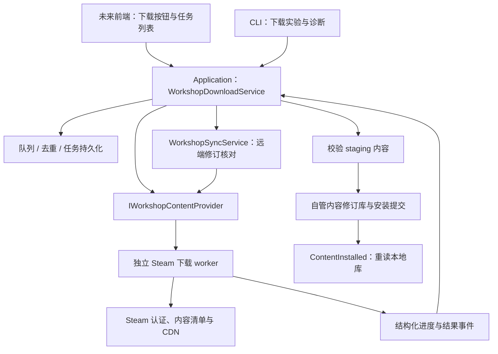

# 应用内工坊下载与内容同步方案

日期：2026-11-01。状态：原始调研与设计。后续已实现第一版，当前实际行为和验证边界见 [应用内下载说明](workshop-download.md)；本文保留当时方案，不能代替实现状态。

本轮只新增本文和项目变更记录，不调整正在由其他 agent 修改的前端，也不改动共享业务代码。下文“现状”和“源码核对”描述已经读过的实现；其余章节是待实施方案，不能当作现有能力。

## 1. 结论与实施顺序

建议借鉴 PCL 的资源版本模型、下载任务编排和校验流程，新增独立的 Steam 内容下载 worker，通过结构化事件向应用报告真实进度。优先用 SteamKit2 / DepotDownloader 路线验证 CK3 的真实下载，再决定正式采用的下载实现；Steamworks 原生接口保留为需要验证运行身份与权限的候选。

第一步是跑通“不依赖界面的一次真实下载、字节统计、校验和再次检查更新”。在此前提成立后，再建设任务服务和让前端接入。单纯把现有按钮改成进度条无法满足需求。

“基本同步”定义为：在打开相关页面、请求下载、下载完成和使用内容前，向 Steam 核对当前发布内容；成功后记录检查时间和实际安装修订。离线时明确保留上次结果。默认不引入工坊列表定时刷新或本地定时扫描。

## 2. 当前代码缺少哪一段

| 环节 | 当前实现与证据 | 下载方案需要补齐的部分 |
| --- | --- | --- |
| 下载入口 | `OpenWorkshop` 只通过系统打开 `steam://url/CommunityFilePage/<id>`。[VERIFY: src/Ck3ModManager.Infrastructure/ExternalNavigator.cs:21] | 创建下载任务、选择 provider、跟踪结果。 |
| 页面提示 | 调用外部导航后提示用户在 Steam 确认订阅。[VERIFY: ，src/Ck3ModManager.Desktop/MainWindowViewModel.cs:488] | 后续由下载任务事实驱动状态，打开链接不能算下载开始。 |
| 远端资料 | 读取标题、更新时间、大小、标签等，并检查 `consumer_app_id`；没有下载内容。[VERIFY: src/Ck3ModManager.Infrastructure/SteamWorkshopSource.cs:43] [VERIFY: src/Ck3ModManager.Infrastructure/SteamWorkshopSource.cs:58] | 登录态、内容定位、manifest、文件清单及传输。 |
| 核心模型 | `WorkshopItem` 保存工坊身份及资料；`InstalledMod` 保存本地路径等，没有内容修订或任务状态。[VERIFY: src/Ck3ModManager.Core/Models.cs:15] [VERIFY: src/Ck3ModManager.Core/Models.cs:39] | 单独新增下载模型，不把内容状态塞进资料缓存。 |
| 资料新鲜度 | 工坊缓存以两分钟为新鲜期，按 `UpdatedAt` 合并资料。[VERIFY: src/Ck3ModManager.Core/WorkshopCache.cs:37] [VERIFY: src/Ck3ModManager.Core/WorkshopCache.cs:46] | 资料缓存新鲜不等于已安装文件为当前内容。 |
| 本地识别 | 扫描用户 `mod/*.mod`，以及工坊 ID 目录中的 `descriptor.mod`；`IsAvailable` 检查内容路径存在。[VERIFY: src/Ck3ModManager.Infrastructure/Ck3ModScanner.cs:29] [VERIFY: src/Ck3ModManager.Infrastructure/Ck3ModScanner.cs:77] | 路径存在不能证明下载完整，必须建立独立的内容验证记录。 |
| 本地变更通知 | 监测快照只比较 `(Id, IsAvailable)`；同路径的内容版本变化不会单凭该比较产生新快照。[VERIFY: src/Ck3ModManager.Infrastructure/FileSystemLocalModMonitor.cs:59] | 安装提交后主动发出一次 `ContentInstalled`，触发定向重读。 |
| 本地身份 | 本地 ID 根据完整内容路径生成，同一工坊 ID 的不同路径可以并存。[VERIFY: src/Ck3ModManager.Infrastructure/Ck3ModScanner.cs:88] [VERIFY: src/Ck3ModManager.Infrastructure/Ck3ModScanner.cs:120] | 升级切换路径时显式维护配置引用，不能假定新旧 `InstalledModId` 一样。 |

这些核对基于当前工作区，前端 agent 后续重构可能改变具体行号与入口位置。

## 3. PCL 具体可以借鉴什么

PCL 参考版本固定为 `93ede5d9e638c99fcec853a9ba1eecd91ceee7f5`。以下 `../PCL/` 路径相对本项目根目录，对应工作区内的参考仓库；也可使用同提交的 [PCL 官方源码](https://github.com/Meloong-Git/PCL/tree/93ede5d9e638c99fcec853a9ba1eecd91ceee7f5)。

| PCL 源码核对 | 本项目的设计映射 |
| --- | --- |
| `ResourceVersion` 从平台数据取得文件名、大小、下载 URL 和 Hash；Modrinth 与 CurseForge 分别解析。[VERIFY: ../PCL/Plain Craft Launcher 2/Modules/Resource/ResourceVersion.vb:128] [VERIFY: ../PCL/Plain Craft Launcher 2/Modules/Resource/ResourceVersion.vb:175] | 定义 `WorkshopContentRevision`，把“展示资料”和“这次真正下载哪一份内容”分开。 |
| `ToNetFile` 将地址、目标位置、Hash 和大小转成下载单元。[VERIFY: ../PCL/Plain Craft Launcher 2/Modules/Resource/ResourceVersion.vb:382] | provider 返回可执行的内容计划，而非工坊网页链接。 |
| 普通资源保存把 `LoaderDownload` 放入 `LoaderCombo`，注册任务状态并加入任务栏。[VERIFY: ../PCL/Plain Craft Launcher 2/Pages/PageDownload/Resource/PageDownloadCompDetail.xaml.vb:518] | 应用层负责排队、状态、取消、失败和安装编排，前端只订阅任务。 |
| `NetFile.Speed` 用下载字节差除以时间差；底层读取响应后增加实际下载计数。[VERIFY: ../PCL/Plain Craft Launcher 2/Modules/Base/ModNet.vb:708] [VERIFY: ../PCL/Plain Craft Launcher 2/Modules/Base/ModNet.vb:1020] | 使用可追溯的字节事件计算速度，避免用等待时间生成百分比。 |
| 分段结果合并后执行 `FileChecker`，失败抛错，检查通过后才 `Finish()`。[VERIFY: ../PCL/Plain Craft Launcher 2/Modules/Base/ModNet.vb:1190] [VERIFY: ../PCL/Plain Craft Launcher 2/Modules/Base/ModNet.vb:1204] | 下载完成后校验，再发布内容并通知本地库。 |

需要区别看待 PCL 的显示进度：`NetFile.Progress` 会把下载映射到 5%～98%，未知大小时使用固定中间值，取消也返回 1；`LoaderCombo` 再按权重聚合。因此不能直接把它的显示百分比解释为真实字节完成率，也不能据此判断成功。[VERIFY: ../PCL/Plain Craft Launcher 2/Modules/Base/ModNet.vb:728] [VERIFY: ../PCL/Plain Craft Launcher 2/Modules/Base/ModLoader.vb:470]

PCL 的 URL、HTTP 分段和源切换逻辑服务于其资源平台。本项目应复用职责划分，独立实现 Steam 的内容定位和下载适配，不能把工坊详情 URL 当作 Mod 文件下载 URL。[VERIFY: ../PCL/Plain Craft Launcher 2/Modules/Resource/ResourceVersion.vb:134] [VERIFY: src/Ck3ModManager.Infrastructure/SteamWorkshopSource.cs:59]

## 4. Steam 下载路线怎么选

### A. Steamworks 原生 UGC：接口最直接，接入条件待验证

官方接口提供 `SubscribeItem`、`DownloadItem`、`GetItemState`、`GetItemDownloadInfo`、`GetItemInstallInfo` 和完成回调。它具备获取真实字节进度和安装位置的能力；`DownloadItem` 返回 true 只是开始成功，读取内容要等待结果回调。[Steam 官方接口](https://partner.steamgames.com/doc/api/ISteamUGC#DownloadItem)

但 SteamAPI 初始化依赖运行中的 Steam、正确 App 身份、同一系统用户和相应许可。官方面向游戏的文档不能证明本第三方多游戏工具具有跨游戏使用这些能力的发布条件。需要独立验证本工具的实际身份、接口访问、SDK 分发条件和六游戏行为；不能仅靠填写 CK3 App ID 就宣布生产接入完成。[SteamAPI 初始化](https://partner.steamgames.com/doc/api/steam_api#SteamAPI_Init)

此路线还有几处明确边界：未订阅的内容可能只是临时缓存；下载接口不适用于旧 RemoteStorage 工坊类型；高优先级会影响其他 Steam 下载；`SuspendDownloads` 暂停的是全部工坊下载，不能包装成无副作用的“暂停此任务”。[官方实施说明](https://partner.steamgames.com/doc/features/workshop/implementation#item_installation)、[暂停接口](https://partner.steamgames.com/doc/api/ISteamUGC#SuspendDownloads)

设计判断：作为候选 provider；在运行身份与权限有结论前，不作为唯一依赖。

### B. SteamKit2 / DepotDownloader：优先验证的独立下载方向

[DepotDownloader](https://github.com/SteamRE/DepotDownloader) 支持 `-app <游戏ID> -pubfile <工坊ID>`，并提供用户登录、二维码登录和指定下载目录。它使用社区维护的 SteamKit2 与 Steam 网络交互，应明确区别于 Valve 官方 SDK。

本轮只读研究上游提交 `49717a7aeb68f3762744b44dbb6d8a01a9ac88da`，没有执行登录或下载：

- 按工坊 ID 读取详情，有 `file_url` 时走 HTTP，否则用 `hcontent_file` 定位内容 manifest，再进入 depot 下载流程。[源码](https://github.com/SteamRE/DepotDownloader/blob/49717a7aeb68f3762744b44dbb6d8a01a9ac88da/DepotDownloader/ContentDownloader.cs#L348)
- manifest 下载流程已有分块复用与检查；内部区分压缩和解压字节，但普通百分比文本在文件完成时输出，HTTP 分支直接 `CopyToAsync`。因此抓取控制台文字不足以直接提供本项目需要的持续字节事件。[分块计数](https://github.com/SteamRE/DepotDownloader/blob/49717a7aeb68f3762744b44dbb6d8a01a9ac88da/DepotDownloader/ContentDownloader.cs#L1357)、[文件复用](https://github.com/SteamRE/DepotDownloader/blob/49717a7aeb68f3762744b44dbb6d8a01a9ac88da/DepotDownloader/ContentDownloader.cs#L1078)、[HTTP 分支](https://github.com/SteamRE/DepotDownloader/blob/49717a7aeb68f3762744b44dbb6d8a01a9ac88da/DepotDownloader/ContentDownloader.cs#L423)
- 上游二维码登录使用 SteamKit 认证会话，取回刷新令牌后保存到自己的账户存储。正式 worker 需要独立设计受保护的会话存储和脱敏，不能直接照搬这个持久化方式。[认证源码](https://github.com/SteamRE/DepotDownloader/blob/49717a7aeb68f3762744b44dbb6d8a01a9ac88da/DepotDownloader/Steam3Session.cs#L470)

设计判断：先以此验证 CK3 下载能力；正式接入采用独立 worker，增加结构化事件，或基于 SteamKit2 实现本项目需要的下载适配。不能假定安装 NuGet 包后就已经具备完整下载器。

复用代码与发布方式另行按上游许可证落实：DepotDownloader 为 [GPL-2.0](https://github.com/SteamRE/DepotDownloader/blob/49717a7aeb68f3762744b44dbb6d8a01a9ac88da/LICENSE)，SteamKit 仓库提供 [LGPL-2.1 许可证](https://github.com/SteamRE/SteamKit/blob/master/LICENSE)。进程隔离是工程边界，本方案不据此推导许可证豁免。

### C. SteamCMD：用于下载能力对照实验

保留 Valve [SteamCMD](https://developer.valvesoftware.com/wiki/SteamCMD) 作为下载能力对照与故障诊断候选；本轮其官方 Wiki 返回 403，未据此确认当前版本的工坊进度输出或跨平台细节。正式选型前应补做版本固定、`workshop_download_item` 行为和进度精度实验。

不能把其他游戏匿名下载成功的例子推广到 CK3，也不能在没有证据时承诺 SteamCMD 能持续输出逐物品字节进度。若只能报告“准备 / 下载中 / 成功 / 失败”，该 provider 就只公开这些能力，不能生成模拟百分比。

## 5. 下载与同步的整体结构



建议的工程归属如下，名称是设计草案，不要求现在修改现有文件：

| 位置 | 新增职责 |
| --- | --- |
| Core 新文件 | `WorkshopContentKey`、`WorkshopContentRevision`、任务快照、provider 能力及接口。 |
| Application 新文件 | `WorkshopDownloadService`、`WorkshopSyncService`；编排、恢复、事件分发。 |
| Infrastructure 新文件 | worker 进程通信、安装记录、内容目录、校验与提交。 |
| 独立 worker 工程 | Steam 认证、内容解析、传输、验证与结构化进度；按游戏身份隔离会话。 |
| CLI | 无前端下载实验、修订比对、失败诊断入口。 |
| Desktop 后续接入 | 提交任务、观察快照、展示实际支持的操作。 |

worker 协议使用带 `ProtocolVersion`、`TaskId`、`AttemptId`、单调 `Sequence` 的 JSON Lines。标准输出只放协议事件，诊断走标准错误并脱敏；不以本地化终端文字、ANSI 百分比或退出码单独认定成功。应用断线后重读任务快照，丢弃旧 attempt 的迟到事件。

认证由用户主动完成，优先验证 Steam 手机扫码；不读取浏览器 Cookie，也不把密码、验证码、令牌放在命令行参数、日志或配置导出中。是否匿名可用逐游戏实测，失败时明确报告需要登录或内容不可访问。认证会话按账户隔离，安装记录按游戏隔离；账户切换后重新核对访问权限。

## 6. 真实进度的契约

任务状态建议为：

```text
Queued → Resolving → AwaitingAuthentication（必要时）→ Downloading
       → Verifying → ReadyToCommit → Installing → Completed
非终态可进入 Failed / Cancelled；崩溃恢复进入 Interrupted 并重新核对。
```

鉴权完成返回解析阶段；无需登录时直接解析下载计划。重试生成新 `AttemptId`，不把上一轮失败的传输累计当作新一轮已完成内容。

| 字段 | 定义 |
| --- | --- |
| `AppId + PublishedFileId` | 实际选择的游戏与工坊发布身份；与卡片聚合名称无关。 |
| `Revision` | provider 实际解析并固定的内容修订；manifest 路线含 depot、manifest 身份，不能用适配标签代替。 |
| `State / LastEventAt` | 当前阶段及最近事实时间；没有事件不意味着有进展。 |
| `VerifiedContentBytes` | 已验证可用的唯一内容字节，含复用块，重试不重复累计。 |
| `TotalContentBytes?` | 来自本次内容计划的逻辑总字节；未知时为 null。 |
| `SessionTransferredBytes?` | 本次实际传输量，与复用量分开；provider 无法量测时为空。 |
| `BytesPerSecond? / Eta?` | 仅根据明确单位的传输事件计算；无数据时不展示数值。 |
| `CompletedFiles / TotalFiles?` | 已验证文件计数；可辅助表示包含很多小文件的 Mod。 |
| `Capabilities` | 是否支持字节进度、取消、恢复、逐任务暂停等；前端按能力展示。 |
| `InstalledPath / ErrorCode` | 只在相应结果产生后填入；错误区分认证、权限、网络、磁盘、校验。 |

下载阶段的百分比仅在总量已知且大于零时计算：`VerifiedContentBytes / TotalContentBytes`。传输量与逻辑内容字节不要混用；压缩、重试或块复用都可能令两者不同。零文件内容先验证类型和有效性，不能因分母为零直接判定安装成功。

对外可显示“下载 100%，正在校验”，任务只有安装提交完成后才是 `Completed`。总量未知时显示阶段、已知字节或文件数及活动指示，不给固定 50% 或按时间增长。原生 Steamworks 若只返回下载字节，则按其返回口径展示，并注明数据来源，不把它改名为已验证内容字节。

worker 最多每 250～500ms 推送一次进度快照，终态与错误立即推送。原生 provider 如需采样，仅在存在活跃任务时读取本地下载状态；这不等同于周期刷新整个工坊目录。无活跃任务时停止采样。

队列以 `(AppId, PublishedFileId, Revision)` 去重；同一工坊项的解析和提交串行化。切游戏只改变观察对象，不丢失下载任务。用户取消与取消订阅是不同操作；provider 不支持单项暂停时不展示该能力，也不调用全局暂停冒充单项暂停。

## 7. 文件如何安全落到可用位置

独立 worker 路线建议自管内容，避免与 Steam 客户端同时写其工坊目录：

```text
<内容根>/steam/<AppId>/<PublishedFileId>/
  staging/<TaskId>/                  # 未提交，扫描器不可当作已安装
  revisions/<RevisionKey>/           # 已验证、不可变的内容
  installation.json                 # 当前修订、校验摘要与检查时间
```

1. 下载前核对返回物品的 App ID、工坊 ID、文件类型及可访问性，集合不伪装成一个 Mod；依赖未知时明确保留未知。
2. 所有文件相对路径都限制在 staging 内，拒绝越界路径、越界链接及冲突路径；检查磁盘容量。终态也要重新检查路径和内容，不能信任 worker 的退出码。
3. manifest 路线按来源提供的块校验与文件清单验证，直接文件路线按来源可提供的长度和摘要验证。没有来源摘要时只能报告实际采用的验证强度；本地 SHA-256 只能作为本地一致性记录，不能冒充来源完整性证明。
4. 读取该游戏的描述文件，确认能够形成当前扫描器识别的内容；完成 `.mod` 外层描述的生成方案，保留 `supported_version`、依赖和必要字段。工坊来源身份与谁管理文件分开记录，不伪装成 Steam 已订阅。
5. staging 和修订目录在同一文件系统内，发布新修订后，以原子替换单个描述文件或当前指针完成切换。安装记录与文件系统之间使用提交日志恢复，不声称多文件写入是一个原子事务。
6. 发出 `ContentInstalled`，显式重新读取相关本地条目。更新配置路径引用要同步处理，或明确保留旧配置所指向的修订；不静默把已保存配置升级到新修订。
7. 游戏运行期间可以下载和校验，但推迟会改变运行配置或活动描述文件的提交。失败、取消、磁盘满和崩溃均保留旧可用修订。

若采用原生 Steamworks provider，则 Steam 管理的目录保持其所有权；等完成回调与安装状态确认后再扫描。自管修订库与 Steam 托管内容是两种管理模式，不应互相覆盖。

上述流程只保证内容被本工具正确识别；“已经下载”“已经加入配置”“已经应用到 Paradox 启动器”“已经在游戏生效”是不同结果，分别验收。

## 8. 怎样保证与工坊基本同步

### 三种身份分别记录

- `PublishedFileId`：作者发布项的身份。
- `RemoteRevision / InstalledRevision`：当前远端内容与本地实际安装的内容身份。manifest 路线优先记录解析出的 manifest；直接文件路线记录来源能提供的版本证据和本地摘要，标注能力较弱。
- 游戏适配声明：作者标签或描述文件中的兼容信息，用于筛选，不能证明文件内容相同。

`time_updated + file_size` 可用于提示可能变化，不能作为唯一的二进制一致性判断；描述文字、标签和内容修订需要分别处理。详情缓存的新鲜期也不能刷新 `LastContentCheckedAt`。

### 默认采用事件触发

| 触发点 | 行为 |
| --- | --- |
| 打开当前游戏工坊页 | 保留现有在线列表刷新策略；仅对可见或已关注条目按需核对内容，不全量扫描目录。 |
| 点击下载或更新 | 绕过展示缓存，解析远端当前内容计划并固定修订。 |
| 下载和校验结束 | 再查一次当前远端修订；若作者在下载期间更新，记录“已安装 R1，远端已有 R2”，按跟随策略排一个合并后的后续任务。 |
| 打开本地库、恢复应用、准备启动 | 对相关已管理内容合并执行一次过期检查，避免每个控件分别发请求。 |
| worker 或 Steam 发出完成通知 | 更新对应安装记录并定向重读本地库。 |
| 用户主动检查更新 | 强制核对所选游戏的已管理项目，支持进度与取消。 |

内容同步状态单独设为 `Current / UpdateAvailable / Checking / UnknownOffline / Unavailable / Pinned`，保存 `LastContentCheckedAt` 和检查来源。这里的 `Current` 只表示检查时本地修订与远端一致，不能承诺未来一直相同。

默认“跟随最新”用于用户选择跟随的内容；存档配置可选择固定本地修订。固定修订继续保留文件并提示远端更新，不自动覆盖。若作者连续发布，新任务合并到最新待办并采用退避，避免不断重启正在进行的下载。

如果需求进一步变成“用户不操作也要在固定时间内发现更新”，需要另行增加可选后台检查或可用的通知源；当前事件触发方案不提供无人操作时的时间上界。Steam 原生订阅的更新时机也由客户端策略影响，不能等同于作者发布后的即时全量同步。[Steam 官方安装流程](https://partner.steamgames.com/doc/features/workshop/implementation#item_installation)

## 9. 可以直接开始的后台工作与验收门槛

### 阶段一：下载可行性实验

新增隔离 CLI / worker 实验入口，不修改 Desktop、现有 `WorkshopService` 或共享 `Models.cs`。先验证 CK3，再扩展到其余游戏。任务输入最少包含游戏 ID、工坊 ID 和自管输出位置。

实验至少覆盖：一个小型公开 Mod、一个多文件或较大型 Mod；匿名结果与用户主动认证结果分别记录。登录必须由用户本人参与，不因本地 Steam 已登录就宣称已取得独立下载会话。本轮没有执行该实验，不把候选路线当作已证实可下载。

通过条件：

1. 解析到与请求一致的 App ID、工坊 ID 和内容修订，产生真实 Mod 文件。
2. 至少一条路线能持续产生定义清楚的字节事件，且下载计数与验证结果对应。
3. 能判断任务成功、权限拒绝和中途失败；未知进度不会被伪造为数字。
4. 可重新查询远端修订、识别已安装相同内容；有可用前后版本样本时验证更新检测。
5. 在目标平台验证认证、网络重连与 Steam 客户端并存行为，不把一台 macOS 上的结果扩展成三平台保证。

### 阶段二：任务和安装服务

在新文件中实现 provider 接口、队列、快照持久化、校验和安装提交。用协议夹具验证重复事件、乱序事件、worker 中断、重试和跨游戏隔离；用临时目录验证路径约束、磁盘失败及崩溃恢复。恢复能力必须通过中断实测，不能仅因底层支持块下载就声称已经断点续传。

此阶段应可从 CLI 完成下载、验证和安装，安装后由扫描器识别；仍可不改前端。同步服务维护内容修订记录，现有资料缓存保持自己的职责。

### 阶段三：前端空闲后接入

将按钮绑定到任务服务，展示任务阶段、真实进度、速度、错误、安装位置和最后同步时间；应用内能观察完成并定位真实文件。需登录、资料可读但内容不可取、离线、已固定旧版等状态都有明确反馈。

首版不承诺任意历史工坊内容可重新下载，也不把“版本下拉”里的游戏适配标签变成历史二进制版本。固定本地修订与重新获取已删除的远端历史内容是两种能力。

## 10. 本轮验证范围

- 已阅读并交叉核对本项目下载入口、元数据模型、资料缓存、扫描与本地事件比较逻辑。
- 已阅读 PCL 固定提交中的资源解析、任务组合、字节计数、显示百分比和文件校验代码。
- 已只读检查 DepotDownloader 固定提交中的工坊内容定位、认证与传输计数；临时参考仓库不纳入本项目依赖。
- 已查阅 Steam 官方接口与实施文档；SteamCMD 官方 Wiki 返回 403 的限制在对应章节明示。
- 本轮只做设计文档核验；没有运行 Steam 登录、订阅、真实 Mod 下载或游戏内容安装，也未构建和测试应用代码。
